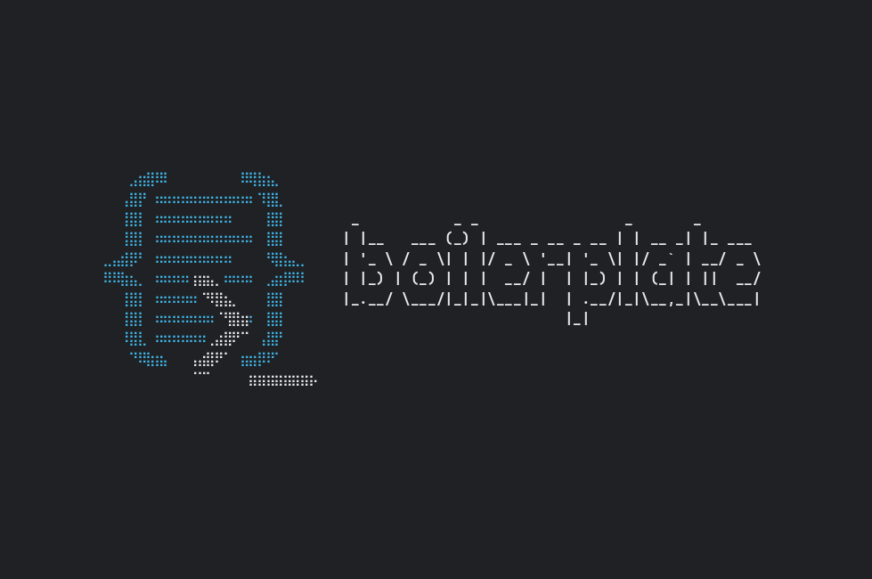

#  Boilerplate

[](https://github.com/TheRealBillSiegler/boilerplate/actions/workflows/ci.yml)
[](LICENSE)

<!-- --8<-- [start:opening] -->
**Boilerplate pairs a Python development environment, one tool for each job, with templates that build on one another to stamp out projects.** Use its templates as they are, or put your own standards on top of one instead of forking it. It renders each template with [Copier](https://copier.readthedocs.io/), a tool for project templates, and you don't need to know Copier to use it.

Boilerplate takes care of the setup chores around writing code, the kind developers call yak shaving: a working toolchain and a configured project. You start at the work.

Each pick is the most modern and lightweight option for its job: uv for installing Python and managing dependencies, Ruff for linting and formatting, Pyright in strict mode for type checking, pytest for testing and VS Code as the editor. The templates configure them in `pyproject.toml` and `.vscode/`, so the editor and the command line format code the same way.

**Less yak. More stack.**
<!-- --8<-- [end:opening] -->



*New project, dependencies installed, pytest passing.*

## Install

You don't need Python first: uv installs it. Boilerplate installs from Git, not PyPI: `pip install boilerplate` gets an unrelated project that owns the name.

On Windows 11, the installer sets up a Python development environment. It installs Git and VS Code unless they're already there, then VS Code's recommended extensions, uv (through Astral's own installer) and the Boilerplate CLI. When it installs VS Code, it also adds a desktop icon, Explorer context-menu entries, file associations and VS Code's PATH entry. It runs from the stock Windows PowerShell and adds PowerShell 7 first if needed. [Read the script](https://github.com/TheRealBillSiegler/boilerplate/blob/main/scripts/install.ps1), then run it:

```powershell
powershell -ExecutionPolicy Bypass -Command "irm https://raw.githubusercontent.com/TheRealBillSiegler/boilerplate/main/scripts/install.ps1 | iex"
```

`-ExecutionPolicy Bypass` applies only to the installer's own PowerShell processes and leaves your machine's policy alone. Only the winget installs need admin rights.

On macOS, Linux and Windows 10, [Install](docs/install.md) walks through the setup by hand; its macOS and Linux steps are still being verified. With [Git](https://git-scm.com/) and [uv](https://docs.astral.sh/uv/getting-started/installation/) already installed, the CLI is one command:

```bash
uv tool install git+https://github.com/TheRealBillSiegler/boilerplate.git@main
```

## Start a project

```bash
boilerplate new project my-app
```

`project` is the template's name. After a few questions, Boilerplate creates `my-app/` with its tools configured. `boilerplate list` shows the other templates, such as one for Streamlit apps.

To put your own standards on top, write a template of your own whose `boilerplate.yml` says `extends: [project]` and holds only your additions, then point Boilerplate at the folder that contains it:

```bash
boilerplate new custom-project my-app --templates-dir ./my-templates
```

Your template applies when you create a project; carrying later changes from `project` into projects you've already made is planned.

## Learn more

- [Documentation](https://therealbillsiegler.github.io/boilerplate/): guides and reference
- [Quickstart](docs/quickstart.md): create and run your first project
- [Why Boilerplate?](docs/why.md): the problem it solves and how its tools were chosen
- [Customization](docs/customization.md): put your own settings and templates on top
- [Status](docs/status.md): what works today and what's planned, before 1.0

## Help and contributing

Stuck? Start with [Help](docs/help.md), then open an [issue](https://github.com/TheRealBillSiegler/boilerplate/issues). To contribute, see [CONTRIBUTING.md](CONTRIBUTING.md).

## License

[Apache License 2.0](LICENSE); the templates' files are [MIT-0](src/boilerplate/templates/LICENSE), so the projects they render owe no attribution.
