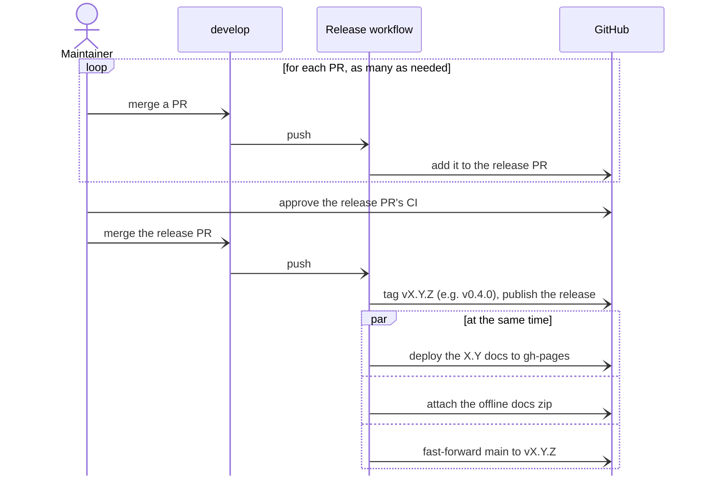

# Release Checklist

The source of truth for "is this safe and complete to release / go public."

To verify: run every gate's command against the current tree — never assert a gate passes without running its check. Report each gate PASS/FAIL with its evidence, and a verdict: **NO-GO** if any Blocker fails; **GO with caveats** if only Quality/Advisory items remain; **GO** if all clear.

Gates are tiered. A **Blocker** failing is a hard no-go (legal / exposure /
irreversible-once-public). A **Quality** failure blocks a *credible* release. An
**Advisory** item is logged, not gating.

## Blockers — legal & no-leak (irreversible once public)

- [ ] `LICENSE` contains the full Apache-2.0 text — `grep -c "Apache License" LICENSE` ≥ 1
- [ ] `src/boilerplate/templates/LICENSE` contains the full MIT-0 text — `grep -c "MIT No Attribution" src/boilerplate/templates/LICENSE` ≥ 1
- [ ] `NOTICE` present and current
- [ ] No non-public identifier (hosts, feeds, registries, people) in the tree or in any tracked **filename** — run the maintainer's identifier scan (its pattern list is kept outside this repository) → zero hits after eyeballing false positives
- [ ] Zip-container assets scanned with the same list — `git grep -I` skips binaries, and formats like `.xmind` are zip archives whose entries (titles, rendered thumbnails) can carry names the text grep never sees. Unzip and grep each one.
- [ ] No secrets committed (tree + history); `uv.lock` resolves only against public PyPI
- [ ] Open-source permission on file for any content seeded from elsewhere

## Quality

- [ ] CI green on the OS matrix (ubuntu / macos / windows × 3.12 / 3.13)
- [ ] `uv run pytest` passes from the repo root; `uv run ruff check --no-fix .` clean; pyright strict clean
- [ ] The `project` template's `uv_build` range (`pyproject.toml.jinja`) and the `streamlit` Dockerfile's `ghcr.io/astral-sh/uv` tag name the current uv minor, and `docs/templates-hub/project.md` quotes the range. A test pins the range and the tag to each other, not to the latest uv, and does not read the docs page, so compare the minor with the newest uv release and move all three in one change

## Packaging metadata (before the first PyPI publish/tag)

- [ ] `pyproject.toml` `name` is the intended PyPI distribution name — see
      [adr-008](docs/design/adr-008-distribution-name.md): `boilerplate-cli` unless the
      `boilerplate` name is acquired
- [ ] When the dist name changes, update `get_version("...")` in
      `src/boilerplate/__init__.py` to match the new dist name — otherwise `__version__`
      reports `Unknown`
- [ ] `description`, `license` (an SPDX expression), `license-files`, `classifiers` (incl. a Development Status; no `License ::` classifier, which PEP 639 deprecates beside an expression), and a
      `[project.urls]` table are complete
- [ ] `[build-system]` requires `uv_build>=0.Y,<0.(Y+1)` for the current uv minor: raise both bounds by hand when uv ships a new minor, because Dependabot is not relied on to raise them. A uv newer than the cap still builds with its bundled backend but warns on every build and install, and each release tag freezes its cap, so installs of older tags warn under a newer uv; that is the cost of uv's recommended upper bound. A uv older than the floor fetches `uv-build` from the index without a warning.
- [ ] OIDC trusted publisher configured against the **final** PyPI project name (do not
      configure until the name is final)

## Versioning & changelog (automated by release-please)

- [ ] The release-please PR is open with the right next version — under SemVer `0.x`,
      breaking → minor and feat → patch (per `release-please-config.json`)
- [ ] The release-please PR moves every install pin to the new tag: the `extra-files` in `release-please-config.json` (the installer and the install commands in the versioned docs; the README names `main`, which holds the latest release)
- [ ] The generated `CHANGELOG.md` entry is accurate. To change its wording, edit the release PR's description, which becomes the GitHub release notes, and `CHANGELOG.md` on the release branch, both right before merging: release-please's next run after a merge into `develop` can replace them.
- [ ] Every release-notes entry is true at the new tag and describes a change since the previous release. Drop an entry about something no release shipped, such as a feature added and changed again between the same two tags.
- [ ] `.release-please-manifest.json` baseline version is correct

## Release mechanics

Releases are cut from `develop`. release-please keeps one release PR open there, titled `chore(develop): release X.Y.Z`, and rebuilds it after every merge. `0.3.0`'s tag and GitHub release were both created by hand at the public cutover, before release-please started watching this repository; everything below describes the automated flow from the next release on.

**Merging the release PR is the release trigger and the only manual step.** Before merging it:

- [ ] Approve the PR's waiting CI runs, then wait for `check` to pass. release-please opens the PR with the workflow's own `GITHUB_TOKEN`, and GitHub holds the runs of such a PR until someone approves them.
- [ ] Read the version and the `CHANGELOG.md` entry against [Versioning & changelog](#versioning--changelog-automated-by-release-please).

The merge starts the Release workflow (`.github/workflows/release-please.yml`). release-please tags `vX.Y.Z` and publishes the GitHub release with the changelog entry, and three jobs then run side by side:

- The versioned docs deploy to the `gh-pages` branch (`docs-deploy.yml`): `mike deploy --update-aliases X.Y latest`, one docs version per MAJOR.MINOR, so patch releases redeploy the same `X.Y`. The first release also runs `mike set-default latest` to write the root redirect, which `mike deploy` never writes, and every release copies its `404.html` to the branch root, where GitHub Pages serves its one site-wide 404 page. Pages serves the branch once it is turned on, at the visibility flip: a Pages site is public even while the repository is private.
- The offline-docs bundle is built at the tag and attached to the release as an optional download (`docs-offline-bundle.yml`).
- `main` fast-forwards to the tag (`main-fast-forward.yml`), pushed with the release App's token (see [One-time setup](#one-time-setup)). The push is never forced, so it fails if `main` holds a commit the tag lacks.

Once a PyPI publish workflow exists (deferred until the distribution name is final, see [adr-008](docs/design/adr-008-distribution-name.md)), it joins them as a fourth job.

The three jobs are independent, so one failing leaves the others to finish. Rerun a failed one for its tag:

- `gh workflow run docs-deploy.yml -f tag=vX.Y.Z`. For a tag older than the newest release it deploys that version without moving `latest`, and it refuses a tag older than its own MAJOR.MINOR's newest patch.
- `gh workflow run docs-offline-bundle.yml -f tag=vX.Y.Z`
- `gh workflow run main-fast-forward.yml --ref develop -f tag=vX.Y.Z`, on `develop`, the only branch the `release` environment accepts

Until the first release after `0.3.0`, every rebuild of the release PR reads all the commits back to `v0.3.0`, more than 800, at about one API request each, against the workflow token's limit of 1,000 requests an hour per repository. A second rebuild within the hour can fail on that limit; the failure changes nothing, and a later run catches up. `release-please-config.json` sets `commit-search-depth` to 1000 so that the first read reaches `v0.3.0`, past release-please's default of 500. Both costs end with that first release, so cut it early.

Milestone versions such as `1.0.0` are never chosen mechanically — the pre-major flags map `feat:` to patch and nothing reaches `1.0.0` on its own. Force one with a `Release-As: 1.0.0` line in the body of any commit that lands on `develop`.

At 1.0, delete `bump-minor-pre-major` and `bump-patch-for-minor-pre-major` from `release-please-config.json` (dead config above 1.0). From then on a single `feat!:` cuts a major with **no deprecation window** — ship the deprecating minor first.

Dependency licenses: all **direct** dependencies are permissive, so distributing boilerplate's own code under Apache-2.0, and its template files under MIT-0, is fine. The vendored third-party works are the Mermaid bundle (MIT) with the libraries it embeds, the asciinema player (Apache-2.0), the IBM Plex Sans and JetBrains Mono fonts (OFL-1.1) and the logos of the tools the docs describe, all credited in `NOTICE`. The docs site and the offline docs bundle serve them — self-hosted deliberately, so using them triggers no third-party fetch — and nothing ships inside the Python package. (Raw Unicode emoji in docs prose still render via Material's twemoji CDN images; icon shortcodes don't. The docs tenets already prefer shortcodes.) The compliance posture is **unmodified redistribution**: the vendored file is byte-for-byte what the Mermaid project publishes (enforced by a `.gitattributes` `binary` entry — line-ending conversion would silently break the claim), upstream's LICENSE is copied verbatim from the pinned tag to `docs/assets/mermaid.LICENSE`, and the license banners inside the file stay intact — never re-minify or post-process it, since those banners are part of the embedded components' attribution (the other embedded components' license texts ship in `docs/assets/licenses/`, listed in `NOTICE`). The bundle does embed an EPL-2.0 component (elkjs); redistributing it unmodified with upstream's source pointer is the same posture Mermaid itself and every CDN takes, and the EPL does not reach boilerplate's own code. Upgrading Mermaid means replacing the vendored file byte-for-byte with upstream's published build and re-copying the LICENSE from the new tag, then re-deriving the embedded libraries and license texts that `NOTICE` credits from the new tag's `pnpm-lock.yaml` and the banners in the new file. There is no recurring automated license-scan gate, by design. The **transitive** tree is not all-permissive — `jinja2-ansible-filters` (GPL-3.0, via copier) and `text-unidecode` (Artistic, via python-slugify) — which is acceptable while dependencies are installed separately from PyPI, but must be revisited before ever shipping a bundled/frozen artifact (PyInstaller and similar). Re-check (`uvx pip-licenses`) when the dependency tree changes.

### One-time setup

`main` moves on a GitHub App's token because the "Protected main" ruleset lets nothing else past its pull-request rule. The App holds only what that push needs, and its key is readable only by workflow jobs that run on `develop`. A bypass covers every rule in its ruleset, so the rules that guard `main`'s history sit in a second ruleset, "Main history", that nobody bypasses: the App can fast-forward `main` but cannot delete it, force-push it or push a merge commit to it.

1. Create a GitHub App on your account (Settings → Developer settings → GitHub Apps → New GitHub App): webhook off; repository permissions Contents: read and write and Workflows: read and write (the commits `main` gains can change workflow files), and no others (GitHub adds Metadata: read-only by itself); installable only on this account. Install it on this repository only, then generate a private key.
2. Create the `release` environment (the repository's Settings → Environments → New environment) with its deployment branches limited to `develop`. Store the App's client ID as the environment variable `RELEASE_APP_CLIENT_ID` and the private key as the environment secret `RELEASE_APP_PRIVATE_KEY`.
3. Add the App to the "Protected main" ruleset's bypass list (the repository's Settings → Rules → Rulesets → Protected main → Bypass list → Add bypass), set to always allow. GitHub accepts the App there only once it is installed on the repository. It stays the only bypass actor, and the ruleset holds only the pull-request and required-status-check rules.
4. Create the "Main history" ruleset (Settings → Rules → Rulesets → New branch ruleset) targeting `main`, with Restrict deletions, Block force pushes and Require linear history, and an empty bypass list.

### Rotating the App's key

The App's private key never expires, so it is replaced by hand: whenever it may have leaked, and otherwise once a year. GitHub lets an App hold several keys at once, so the old key keeps working until the new one is proven.

1. In the App's settings (Settings → Developer settings → GitHub Apps → the release App → Edit → Credentials → Key pairs), click **New key**. GitHub downloads it as a `.pem` file.
2. Store it from the file, not the clipboard: `gh secret set RELEASE_APP_PRIVATE_KEY --env release < path/to/key.pem`. Then delete the file.
3. Prove it: `gh workflow run main-fast-forward.yml --ref develop -f tag=vX.Y.Z`, naming the latest release. With `main` already at that tag, the run mints a token and pushes nothing.
4. Back under Key pairs, delete the older key.

If the old key may have leaked, delete it straight after step 2, before the check: until it is gone, anyone holding it can mint tokens.

---

During `0.x`, only the distribution name is a stable commitment (see [Versioning & Compatibility Policy](docs/governance/versioning.md)); other CLI/exit-code/output surfaces may change.
