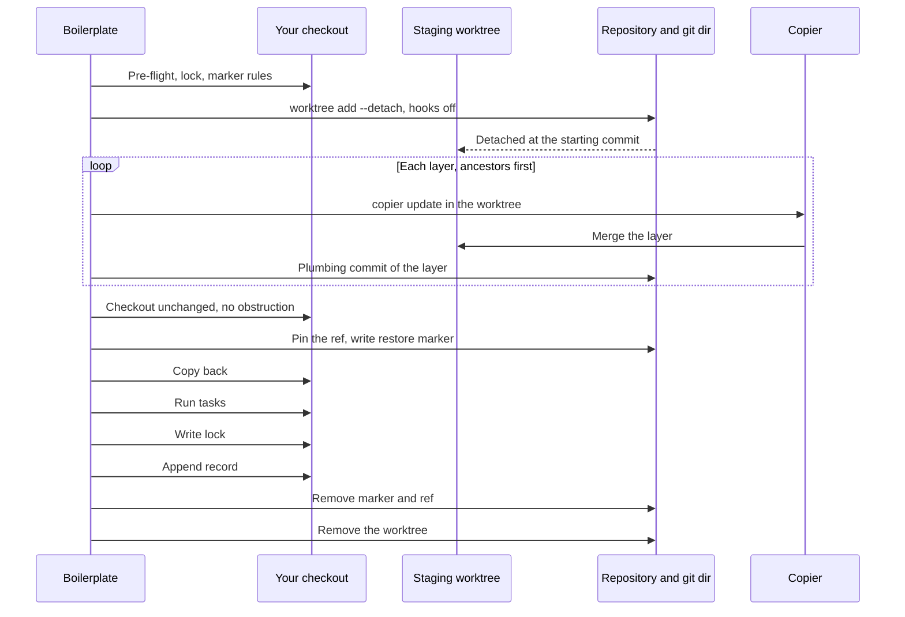

# Project Lifecycle

## Purpose

This document specifies the lifecycle of a Boilerplate-managed project: creation, update, layer addition, adoption, and ejection — covering workflows, lock file management, staging, and migration records.

---

## Project State Files

A Boilerplate-managed project contains the following state files after creation:

| File | Owner | Purpose |
|------|-------|---------|
| `boilerplate.lock` | Boilerplate | Records exact versions, commit hashes, and checksums of all template layers used |
| `.copier-answers.<layer>.yml` | Copier | One file per template layer; records answers collected during interactive prompting for that layer. Each first-party template declares its file via `_answers_file:` (see [04-composition-engine.md §Render Behavior](04-composition-engine.md#render-behavior)). |
| `.boilerplate/migrations.yml` | Boilerplate | Append-only audit log of all update operations (project domain) |

Environment-domain state files (`.boilerplate/environment.yml`) are documented in [§08 State Files](08-environment-provisioning.md#state-files).

**Ownership invariants**:
- Boilerplate MUST NOT write to any `.copier-answers.<layer>.yml` file (one per template layer). Those files are owned by Copier.
- External tools MUST NOT write to `boilerplate.lock`. That file is owned by Boilerplate.
- `boilerplate.lock` MUST only be written after a fully successful operation (creation or update). It MUST never reflect a partial state.

---

### Concurrency

The universal advisory-lock rule and timeout default are defined in [07-operational-quality.md §Concurrency Control](07-operational-quality.md#concurrency-control). It applies to every mutating Boilerplate operation: `new`, `update`, `add`, `adopt`, `eject`, `env apply`. Project-domain specifics:

- **Lock target (existing project)**: a `boilerplate-operation.lock` file in the project's git directory, at the path `git rev-parse --git-path boilerplate-operation.lock` prints, so each worktree of the project has its own lock. The target is not `boilerplate.lock` for two reasons: Boilerplate writes that file by replacing it with a renamed file, which Windows refuses on a file the operation holds open, and a lock file inside the working tree would dirty the tree and fail the clean-tree check. A project that is not a git repository uses the `new` target below.
- **Lock target (`new`)**: a `.boilerplate-lock-{destination_name}` file created in the destination's parent directory. The file is created if absent and removed after the `new` operation completes.

**Network filesystem detection**: `boilerplate doctor` MUST detect and warn when the project directory or staging root resides on a network filesystem (advisory file locking is unreliable there; see [§07 Network Filesystems](07-operational-quality.md#network-filesystems)).

---

## Part 1: Project Creation

### Overview

Project creation takes a template reference, resolves its full dependency graph, composes a merged configuration, renders each template layer atomically into a destination directory, and writes `boilerplate.lock`.

### Creation Pipeline

```text
1. Resolve   →  Dependency graph from boilerplate.yml extends chains
2. Compose   →  Merge configurations from all layers
3. Render    →  Atomic: stage → copy → verify → commit
4. Lock      →  Write boilerplate.lock after successful commit
5. Init      →  Append initial MigrationRecord to .boilerplate/migrations.yml (status: created)
```

### Step 1: Template Resolution

Resolve the template reference via the catalog and traverse the `extends` chain to build the full dependency graph. See [04-composition-engine.md](04-composition-engine.md) for the resolution algorithm and graph validation.

**Version constraint resolution**: Template references resolve to either the latest version (unversioned `"name"`) or an exact version (`"name@version"`). See the Resolver's template lookup behavior described in [04-composition-engine.md](04-composition-engine.md).

### Step 2: Composition

- Extract `copier.yml` configuration from each template in topological order
- Merge configurations using the `CopierConfigMerger` (see [04-composition-engine.md](04-composition-engine.md))
- Produce an immutable `CompositionArtifact`

### Step 3: Atomic Staged Write

This step follows the [Atomic Staged Write Pattern](07-operational-quality.md#atomic-staged-write-pattern). Project-creation specifics:

- **Intent journal name**: `.boilerplate-commit-intent.json`, written in the staging directory.
- **Phase enum**: `staging`, `committing`, `locking` (recovery rules in [§02 IntentJournal](02-data-models.md#intentjournal)).
- **Stale-staging window**: 1 hour, owner-checked (POSIX UID match; Windows ACL full-control check).
- **Recovery rule**: on failure or signal, delete staging and leave destination untouched.

Project-specific invariants beyond the shared pattern:

- Git submodules MUST be initialized recursively before YAML parsing. Failure aborts with `BP_RENDER_SUBMODULE_FAILED`.
- Layers are rendered in topological order (dependencies first). Later layers completely override earlier layers for files at the same path (no content merging).
- Answers are collected once on the first layer; subsequent layers reuse them. Tasks run on the final layer only.
- After tasks execute, path safety validation MUST re-run on staging contents (closes the TOCTOU window for malicious tasks). This applies to both standard rendering and `--render-to`.
- The commit phase moves staging to destination. With `--force`, the existing destination is backed up first. On Windows, directory rename is not atomic — best-effort crash safety only.

### Staging cleanup on retry

On retry, the staging directory and its intent journal MUST be completely removed and recreated before the next attempt. Retrying into a staging directory with partial output could produce corrupted results.

**File overlay semantics**: File overlay follows the composition engine's full-file replacement rule. See [04-composition-engine.md §Managing Shared Files Across Layers](04-composition-engine.md#managing-shared-files-across-layers). Layers are rendered in topological order; later layers completely replace earlier layers' files at the same path.

### Step 4: Lock File Generation

After a successful commit, write `boilerplate.lock` to the project root. See [02-data-models.md](02-data-models.md) for the full `BoilerplateLock` schema and invariants.

The lock file records the following per layer: `name`, `version`, `source`, `commit` (git SHA or null), and `checksum` (SHA-256 of template source directory content). It also records `schema_version`, `boilerplate_version`, `copier_version`, `root_template`, `copier_answers_file_hashes` (the per-layer answers-file hashes), and timestamps. See [02-data-models.md](02-data-models.md) for the full `BoilerplateLock` schema.

**Key concepts**:

- `checksum` fields use `"sha256:{hex}"` prefix format (forward-compatible with future algorithms). The per-layer `copier_answers_file_hashes` values use bare hex (always SHA-256 by definition).
- Checksums are computed over all files in the template source directory content (excluding `.git/`, `__pycache__/`, `.mypy_cache/`, `.pytest_cache/`, `.ruff_cache/`, `node_modules/`), sorted lexicographically by relative path, concatenating path and content. This list is fixed and MUST NOT depend on `.gitignore`. Template authors MAY declare additional exclusions via `checksum_excludes` in `boilerplate.yml` (see [02-data-models.md](02-data-models.md)). See [02-data-models.md](02-data-models.md) for the authoritative checksum computation specification.
- Each layer MAY include optional `bundle_uri` and `bundle_checksum` fields. These are air-gap / enterprise restoration fields, populated by external catalog infrastructure (not Boilerplate itself) and not part of the core provenance contract. The `wheel_bundle` source type and its `source_bundle` / `subdirectory` lock fields are deferred with the seed cache they support ([ADR-006](adr-006-template-distribution.md)); layers sourced from the published first-party repositories record `null` for both.

### Lock File Recovery

If `boilerplate.lock` is corrupted (unparseable YAML, truncated write, invalid schema version), Boilerplate MUST:

1. Fail with `BP_LOCK_READ_FAILED` and remediation guidance: `"Lock file is corrupted. To recreate: delete boilerplate.lock and run 'boilerplate new <template> . --force' to regenerate from the current project state."`
2. NOT attempt automatic repair — the lock file records provenance data (commit hashes, checksums) that cannot be reconstructed from the project alone.
3. The `status` command MUST report lock file corruption as a top-level diagnostic.

> **Prevention**: Lock files MUST be written atomically (temp file + rename) so interrupted writes cannot leave a partial file.

### Lock File Versioning

The `schema_version` field (`"boilerplate/lock@1"`) enables forward-compatible evolution. Boilerplate MUST parse any lock file whose schema version shares the same major version (e.g., `boilerplate/lock@1` through `boilerplate/lock@1.x`). Minor version bumps add optional fields; major bumps may change semantics.

A lock whose `schema_version` major exceeds the major the running tool supports MUST be refused (fail closed). The tool MUST NOT read from or mutate a lock from a newer schema generation; on encountering one it MUST fail closed with a clear error (`BP_LOCK_SCHEMA_UNSUPPORTED`): "This project was created with a newer version of Boilerplate. Please upgrade." It MUST NOT silently ignore the version mismatch or attempt to partially parse the newer schema. This guards every lock-reading operation (`update`, `status`, `lock verify`).

### Step 5: Project State Initialization

After the lock file is written:
1. Append the initial `MigrationRecord` to `.boilerplate/migrations.yml` with `status: created` (the audit log's first entry; `id: "1"`, `from_version: null`, `to_version: <root template specifier>`, `classification: null`). The file is created with this record as its only entry — no separate "empty initialization" step. The `created` record is the project-creation provenance entry required by [§01 Safety-first operations](01-overview.md#safety-first-operations).
2. Initialize a git repository if `--git-init` is specified (see [05-cli-reference.md](05-cli-reference.md))

### Acceptance Criteria

| Scenario | Expected Outcome |
|----------|-----------------|
| Valid single template | Template rendered, `boilerplate.lock` written, exit `0` |
| Valid composed template | All layers rendered in order, lock includes all layers, exit `0` |
| Template not found | `DependencyNotFoundError`, no output written, exit `1` |
| Circular dependency | `DependencyCycleError` with full cycle path, exit `1` |
| Non-empty destination without `--force` | `DestinationNotEmptyError`, exit `3` |
| Rendering fails mid-stream | Staging deleted, destination untouched, exit `1` |
| Same inputs repeated with `--force` | Bit-identical output (idempotent), exit `0` |

### Performance Contracts

See [07-operational-quality.md](07-operational-quality.md) for all performance targets.

---

## Part 2: Project Update

### Overview

Project update takes an existing Boilerplate project (with `boilerplate.lock`), resolves the new target template version, computes what changed, applies a three-way merge to preserve local modifications, writes a new lock file, and appends a migration record.

**Safety model**: Update computes a plan, displays it to the user, and prompts for confirmation (`Proceed? [y/N]`) before applying. `--dry-run` prints the plan and exits without prompting. `--yes` skips the prompt and applies immediately. See [05-cli-reference.md](05-cli-reference.md) for the full CLI contract.

### Pre-Flight Check

Before starting the update pipeline, Boilerplate MUST run these checks in order:

1. The project is a git repository root with at least one commit.
2. Take the operation lock ([07 §Concurrency Control](07-operational-quality.md#concurrency-control)). Every check below runs inside the lock, so no second Boilerplate operation interleaves with a check.
3. Run the [restore-marker rules](#interrupted-copy-back). A cut-off run's marker is finished (and the command then ends), discarded or reported before anything reads the working tree, which that run may have left dirty. When the ref `refs/worktree/boilerplate/restore` exists and the marker does not, a crash fell between the two steps of the copy back's bracketing; remove the ref (`git update-ref -d`) and continue.
4. The project has no uncommitted changes, untracked files included. This is Copier's own rule: Copier refuses to update a project whose `git status --porcelain` is not empty.
5. The project has no submodules (a `.gitmodules` file). Otherwise Boilerplate MUST stop with `BP_UPDATE_SUBMODULES_UNSUPPORTED` and exit code `3`, naming the submodule paths, because git's worktree documentation says multiple checkouts of a superproject are not recommended ([git-worktree](https://git-scm.com/docs/git-worktree)).

When check 1 or check 4 fails, Boilerplate MUST fail immediately with `BP_UPDATE_PROJECT_NOT_READY` and exit code `3`. Check 1 reports `"Not a git repository root with at least one commit."` and check 4 reports `"Working tree has uncommitted changes. Commit them, or run 'git reset' and then 'git stash --include-untracked', before running boilerplate update."` `update` has no override; the tree is clean, or the update does not start.

### Update Pipeline

```text
1. Load     →  Read boilerplate.lock + each layer's .copier-answers.<layer>.yml
2. Resolve  →  Resolve each layer's target version
3. Plan     →  Compute UpdatePlan (diff old vs new)
4. Apply    →  Walk the layers in a staging worktree, then copy the result back (after user confirmation)
5. Lock     →  Write new boilerplate.lock
6. Record   →  Append migration record to .boilerplate/migrations.yml
```

### Step 1: Load Current State

- Read `boilerplate.lock` to determine the current template versions, dependency graph, and per-layer answers-file hashes.
- Read each layer's `.copier-answers.<layer>.yml` to retrieve the answers used for the current project state. Each layer's answers file records the answers to its own and its ancestors' questions, the questions of its [scoped view](04-composition-engine.md#scoped-view); the walk passes each layer's `copier update` invocation the data [design 04 §Safe Update](04-composition-engine.md#safe-update) specifies.
- For each layer, compute the SHA-256 hash of the raw `.copier-answers.<layer>.yml` file contents and compare against the corresponding entry in `copier_answers_file_hashes` in `boilerplate.lock`. If any layer's hash differs, emit a WARNING: `"Answer state for layer '{layer}' may have been externally modified since the last Boilerplate operation. The update will use the current .copier-answers.{layer}.yml contents."`. The update proceeds despite the mismatch — the warning is informational, not blocking.
- If any required answers file is missing or corrupted, fail with a clear error before proceeding.
- Before any layer runs, three more checks, each stopping the update with its own error listed in the outcomes table below, look for layer drift, an incomplete answers file and, on a resume, targets that differ from the pending `conflict` record's ([design 04 §Safe Update](04-composition-engine.md#safe-update)).

### Step 2: Resolve Target

- Each layer the lock lists resolves its own target version, using the same deterministic rules as project creation. Default: the latest available version of that layer that the `extends` constraints of the lock's layers allow.
- Support explicit target versions: `--target-version <version>` names the root template's target, and `--target-version <layer>@<version>`, repeatable, names the target of the layer called `<layer>` in the lock.
- A target that names a layer the lock does not list MUST stop `update` before anything is staged with `BP_UPDATE_LAYER_UNKNOWN`, naming each unknown layer and listing the project's layers.
- An explicit `<layer>@<version>` that the `extends` constraint of another layer in the lock excludes MUST stop `update` before anything is staged with `BP_UPDATE_TARGET_EXCLUDED`, naming the layer, the requested version and the constraining layer.
- Downgrades MUST be rejected, with no flag to override. Before the walk starts, `update` MUST compare each layer's target version with the version that layer's answers file records in `_commit`, parsed the way Copier parses it, with Copier's own `Template.version` (a `git describe` string such as `v2.0.0-3-gabc1234` reads as a post-release of `2.0.0`, which sorts after `2.0.0`). When any target is older, `update` MUST stop before any layer changes with `BP_UPDATE_DOWNGRADE_REJECTED`, naming the layer, its recorded version and the target. The same rule applies when a recorded `_commit` yields no version. The way back from an applied update is reverting the commit that recorded it.

### Step 3: Build UpdatePlan

The `UpdatePlan` summarizes what will change if the update is applied.

**UpdatePlan fields**:

| Field | Description |
|-------|-------------|
| `current_root` | Current root template specifier |
| `target_root` | Target root template specifier |
| `layer_changes` | List of per-layer version changes |
| `classification` | Overall change classification: `PATCH`, `MINOR`, or `MAJOR` |
| `migrations_required` | List of required migration actions (if any) |

**Classification rules** (highest wins):
- Any layer MAJOR bump → overall `MAJOR`
- Any layer MINOR bump (no MAJOR) → overall `MINOR`
- All PATCH bumps → overall `PATCH`

**Per-classification safety guarantees**. Each classification carries a contract that template authors MUST honor and that update tooling relies on:

| Classification | Guarantees | Migration required? |
|---|---|---|
| `PATCH` | No removed files (except transient cache artifacts); no question name changes (defaults MAY adjust); lock differences limited to version + checksum bumps | No |
| `MINOR` | Existing file semantics preserved; new files additive (conflict only if user created a colliding file); new questions appended with defaults; existing answer values retained | No (unless `compatibility.breaking: true` flagged on the target version, which forces classification escalation to MAJOR for planning purposes) |
| `MAJOR` | Potential breaking changes: removed files, renamed questions, relocated paths, replaced dependencies | Yes |

**Migration trigger conditions**. The `migrations_required` list MUST be non-empty when ANY of the following hold for the target version:

- MAJOR version increment (across any layer).
- Target template metadata declares `compatibility.breaking: true`.
- A previously-required question is removed from the merged composition.
- A structural file relocation alters expected import paths.
- The `extends` chain replaces a dependency with one that is not API-compatible (e.g., `python-base` → `python-core`).

Optional (advisory) migrations MAY be offered when files are soft-deprecated or configuration keys are superseded; these do NOT block update execution.

**Pre-release version handling**. Pre-release identifiers (`1.0a1`, `1.0rc1`, etc.) are lower precedence than final releases of the same release version, per [§02 Version](02-data-models.md#version) PEP 440 ordering. Update target resolution skips pre-release versions by default; the user MUST pass `--allow-prerelease` to opt in. A transition from pre-release to its corresponding final release (e.g., `1.0a1` → `1.0`) is classified as `PATCH` for planning purposes if all release-version segments are unchanged; otherwise it is classified per the standard rules.

**Example UpdatePlan output**:
```text
Update plan for my-app:
  project    0.1.0 → 0.2.0  (MINOR)
  streamlit  0.1.0 → 0.1.1  (PATCH)
Overall classification: MINOR
Migrations required: none
```

When `--dry-run` is active, print the UpdatePlan and exit without prompting or modifying the project.

**Structural changes to the `extends` chain**: When a template update adds or removes parent templates (changes to the `extends` list), the UpdatePlan MUST detect and report this:

- **Added dependency**: A layer the root's target version reaches through `extends` that was not in the previous composition. The UpdatePlan MUST list it as an `ADDED` layer, and its lock entry records `joined_via: extends`. It has no merge base, so Boilerplate MUST render it as a copy that writes only paths not already present, with a skip pattern matching every path (`skip_if_exists=["*"]`): Copier checks `skip_if_exists` before `overwrite` (`Worker._solve_render_conflict` tests `match_skip` before `overwrite`, read at Copier 9.18.1), and the Worker's patterns join the template's in `Worker.all_skip_if_exists`. A descendant's file therefore keeps its precedence as at compose, where a rendering with `overwrite` would replace it and the descendant's step would then see that as a user change. The update MUST report each colliding path it left.
- **Removed dependency**: A layer that joined through `extends` (`LockLayer.joined_via`, [02 §BoilerplateLock](02-data-models.md#boilerplatelock)) and that the root's target version no longer reaches. The UpdatePlan MUST list it as a `REMOVED` layer. Boilerplate drops the layer from the managed layer set and lock; it does NOT infer file provenance and does NOT auto-delete the removed layer's files. Cleanup of a removed layer's artifacts is the responsibility of a Copier `_migrations` script in the template that removed the dependency. When no such migration is provided, the removed layer's files are left in place (now unmanaged) and the user is WARNED: the warning names the removed layer and points to the migration as the cleanup mechanism. See [adr-007-update-model.md](adr-007-update-model.md). The rule never applies to a layer that joined through `add`: the root's target does not govern it, so it stays in the lock and in the walk until it is removed on purpose. That holds when a later root target reaches the layer through `extends`: it keeps `joined_via: add`, is not reported as `ADDED`, and the `extends` constraint still bounds the version it walks to.
- **Classification**: Any structural change to the `extends` chain (addition or removal of layers) MUST be classified as at least `MINOR`, regardless of version bumps within existing layers.

### Step 4: Three-Way Merge

Three-way merge semantics preserve local modifications while incorporating template changes. **Boilerplate does NOT implement its own three-way merge.** All merging is performed by Copier's per-template `update` mechanism; Boilerplate orchestrates the per-layer invocations and owns the staging worktree around them.

> **Why per-layer Copier `update`?** Copier enforces a "1 template = 1 Git repository" rule, so the documented mechanism for multi-template projects is one `copier update -a <answers-file>` invocation per template. Boilerplate MUST NOT reimplement three-way merge — Copier already provides three-way semantics per layer via that template's own Git history; Boilerplate only orchestrates the per-layer invocations.

**Merge inputs (per layer, owned by Copier)**:
- **Base**: The layer's old copy, rendered under its scoped view at the versions it was last rendered against: the layer's own `_commit` for its own template and `boilerplate.lock`'s versions for its ancestors ([design 04 §Safe Update](04-composition-engine.md#safe-update)).
- **Theirs**: The layer's template content at the target version (the new commit).
- **Ours**: The current project files (potentially modified by the user since last render).

**Safe update**:

- **Single-layer projects** (no `extends`): Run the one layer's update through the same `Worker` subclass; its scoped view is the layer's own schema. Boilerplate writes `boilerplate.lock` afterward.

- **Multi-layer compositions** (templates with `extends`): Boilerplate orchestrates per-layer updates by running Copier's `update` per layer in lock order (`copier update -a .copier-answers.<layer>.yml --vcs-ref=<target>` is the operation), each through the layer's scoped view ([design 04 §Safe Update](04-composition-engine.md#safe-update)). Each layer's three-way merge is performed by Copier against that layer's own Git source — the published first-party repository, or an org-local clone or mirror of it ([ADR-006](adr-006-template-distribution.md)). Layer-level success/failure is each layer's own atomic-from-Copier operation; Boilerplate stages the walk in a git worktree and brings the result back as uncommitted changes (see [Staging worktree](#staging-worktree) and [Step 5](#step-5-failure-and-conflict)).

The per-layer answers files (`.copier-answers.<layer>.yml`) record the answers each layer's update starts from, written at creation time per the [`_answers_file:` contract](04-composition-engine.md#render-behavior). [Design 04 §Safe Update](04-composition-engine.md#safe-update) owns where each answer in a layer's step comes from, how the step prompts and checks recorded answers, how `--set` and `--answers` replace a rejected one, and when the walk runs tasks.

**Non-git template sources**: If any locked template layer's source is a non-git source type (`filesystem` without a `.git/` directory, or `archive`), it has no commit for Copier to diff against — Copier has no three-way *or* two-way fallback for it ([ADR-015 §Verification](adr-015-idiomatic-artifacts.md#verification-2026-07-28)). Boilerplate surfaces this:

1. Warn the user prominently before proceeding: `"Template source '{name}' is a non-git source; skipping it — 'copier recopy' is the manual refresh for this layer."`
2. Skip the layer; the walk continues with the remaining git-backed layers.
3. Log the skip at WARN level with the source type and template specifier.

The refusal Boilerplate is working around here is Copier's existing behavior; the skip-and-continue walk above is Boilerplate's orchestration policy around it.

### Copier version management for update

`boilerplate.lock` records the Copier version the project was last rendered or updated with (`copier_version`). `boilerplate update` runs with the installed Copier. When the installed Copier version differs from the recorded one, `boilerplate update` MUST emit a warning naming both versions, then proceed. The new lock records the Copier version this update ran with.

### Source repository unavailability

If the template source repository referenced in the lock file has been deleted, relocated, or had its history rewritten (force-push removing the locked commit), Copier cannot reach the locked commit needed for its per-layer three-way merge. Boilerplate's role is detection and surfacing the override path:

1. Raise `BP_LOCK_SOURCE_UNAVAILABLE` (not `BP_LOCK_READ_FAILED`) with remediation guidance.
2. The `update` command MUST support a `--template-source <path-or-url>` override that allows the user to point Copier at an alternative source (e.g., a fork, mirror, or local copy) so its per-layer three-way merge can resolve the locked commit.
3. If no alternative source is available, that layer's update cannot proceed — Copier has no built-in two-way fallback ([ADR-015 §Verification](adr-015-idiomatic-artifacts.md#verification-2026-07-28)). Boilerplate skips the layer with a prominent warning and continues the walk with the remaining layers; `copier recopy` is the manual refresh once the source is restored.

Template source repositories SHOULD be treated as critical infrastructure. The lock file records the source URL and commit hash per layer, but does not embed the template content itself — source availability is required for updates.

### Staging worktree

`update` runs the walk in a detached git worktree of the project, so the user's checkout changes only when the update has finished or paused on a conflict. `add` uses the same staging ([Part 2.4](#adding-a-layer)).

The **copy back** is the step that reproduces the walk's result in the user's checkout. It is `git restore --source=<commit> --worktree -- :/` run in the checkout, where `<commit>` is the staging worktree's last per-layer commit. git(1) says `git restore` "is about restoring files in the working tree from either the index or another commit. This command does not update your branch", so the copy back moves neither HEAD nor the branch and leaves the uncommitted changes plain Copier leaves. git-restore adds: "If a path is tracked but does not exist in the restore source, it will be removed to match the source", so files the walk deleted are removed along with the ones it added or modified ([git-restore](https://git-scm.com/docs/git-restore)).

The diagram follows one `update` from the pre-flight check to the removal of the worktree. The [restore marker](#interrupted-copy-back) and its ref bracket the copy back, so a run cut off inside it leaves state in git. On a conflict, the run skips the tasks and the lock and appends a `conflict` record.



1. **Create.** After the [pre-flight check](#pre-flight-check) and the user's confirmation, Boilerplate MUST create a detached worktree of the project at its current commit (`git -c core.hooksPath=<null device> worktree add --detach`) in the system temp directory, inside a uniquely named folder, created owner-only ([10 §File Permissions](10-security.md#file-permissions)), whose own name is the project folder's name. Copier exposes the destination folder's name as `_folder_name`, and templates use it as a default, so the staged render matches a render in the user's folder.
    - The worktree shares the repository's config, so line-ending, filter and LFS settings match the user's checkout.
    - A detached HEAD adds no branch to the repository.
    - `git worktree add` runs the repository's `post-checkout` hook (observed with git 2.55), so Boilerplate MUST create the worktree with hooks disabled, as Copier runs its own git commands where a hook would interfere (`-c core.hooksPath=<null device>`, as `Worker._apply_update` does, read at Copier 9.18.1). The null device is `os.devnull`.
    - Boilerplate MUST commit in the worktree with git's plumbing (`git write-tree`, `git commit-tree`, `git update-ref`), so the user's hooks do not run.
2. **Walk.** Boilerplate MUST run the walk ([design 04 §Safe Update](04-composition-engine.md#safe-update)) in the worktree, ancestors first, and commit after each layer. Copier refuses to update a project with uncommitted changes, so the commit is what lets Copier update the next layer.
3. **Fail.** Any error, a cancelled prompt or a rejected answer MUST remove the worktree. The user's checkout never changed, and no lock is written.
4. **Succeed.** Before copying back, Boilerplate MUST verify that the user's checkout is still at the starting commit with no changes; if not, it MUST discard the worktree and stop with `BP_UPDATE_CHECKOUT_CHANGED` and exit code `3`. It MUST likewise stop with `BP_UPDATE_PATH_OBSTRUCTED`, before any file changes, when a path the walk added already exists in the checkout as a file or directory git ignores, naming each path, because the restore would overwrite that file or delete that directory without warning. Before the copy back changes a file, it MUST pin the copy back's source commit with the ref `refs/worktree/boilerplate/restore` and then write the restore marker ([Interrupted copy back](#interrupted-copy-back)). If the copy back fails partway, Boilerplate MUST undo it ([Undo](#undo)), keep the staging worktree, remove the marker and the ref, and stop with `BP_UPDATE_COPY_BACK_FAILED`, naming the worktree's path, so the walk's result is not lost; it appends no record, because the undo returns the checkout to its pre-update state. Otherwise the copy back leaves the uncommitted changes plain Copier leaves, and Boilerplate runs the tasks, writes the lock, appends the record, removes the marker and the ref, and removes the worktree. Because the copy back restores from a commit, files the walk added and files it deleted both apply; a copy of the worktree's files cannot carry a deletion, such as one Copier's `_remove_old_files` makes (the `_remove_old_files` call in `Worker._apply_update`, read at Copier 9.18.1).
5. **Conflict.** When a layer's update returns conflicts (Copier inserts standard `<<<<<<<` / `=======` / `>>>>>>>` markers in affected text files), Boilerplate MUST stop the walk, copy back the layers finished so far together with the paused layer's changes and Copier's conflict markers, and write no lock. The paused layer is not committed in the worktree, so after the restore the copy back also applies the worktree's remaining working-tree changes (files the paused layer added or modified are written and files it deleted are removed, as `git status --porcelain=v1 -z` lists them) and replays its unmerged index entries: Copier records each conflicted file as index stages 1, 2 and 3 (the `if conflicted:` block of `Worker._apply_update`, read at Copier 9.18.1), which the copy back reads with `git ls-files --stage` in the worktree and writes with `git update-index --index-info` in the checkout, after a line that drops the path's stage 0 as Copier does. The worktree shares the checkout's object store, so the staged blobs resolve in both. The conflicted files then show as unmerged and `git commit` refuses them, as with plain Copier. The restore marker of this copy back has `kind` `paused` and holds the layers the walk finished and the paused layer; the run appends the `conflict` record and then removes the marker and the ref. See [Step 5](#step-5-failure-and-conflict).

Stale worktrees left by an interrupted run are removed by the stale-staging cleanup of [07 §Atomic Staged Write Pattern](07-operational-quality.md#atomic-staged-write-pattern).

#### Undo

Undo restores every tracked file, in the working tree and the index, from the starting commit, and removes the untracked files that git does not ignore (`git clean -d -f`, without `-x`). It does not reverse files git ignores, anything inside `.git` (a commit a task made, a moved `HEAD`) or anything outside the project, so an effect a task has there stays. Task authors SHOULD keep tasks idempotent, so that running one again after an undo is safe ([ADR-014](adr-014-deferred-task-execution.md#consequences)). `update` and `add` refuse to start while untracked files are present ([Pre-Flight Check](#pre-flight-check), check 4), so every untracked file the undo removes came from the run. Boilerplate lists the untracked files before it asks the user to keep or undo, and passes only the listed paths to `git clean`, so a file the user makes while that prompt waits is not removed. A copy back that fails is undone the same way, without a prompt.

Before the tasks run, Boilerplate notes the entries git ignores in the checkout (`git ls-files --others --ignored --exclude-standard --directory`). After an undo that follows a task failure, it names the ignored entries that are new and never deletes them. The note lists an ignored folder that already existed, such as `.venv`, as one entry, so Boilerplate cannot see changes inside it, and the message says so. A rerun that finishes a run cut off during its tasks ([Interrupted copy back](#interrupted-copy-back), rule 5) takes the note when the rerun starts, so it does not name an ignored entry the cut-off run's tasks made.

### Merge behavior and ordering

**Per-file merge behavior**: Per-file merge semantics (clean updates for unchanged files, conflict-marker insertion for text-file conflicts, binary-conflict reporting for binary files, modify/delete handling, etc.) are owned by Copier's `update` mechanism. Boilerplate does not specify or implement these semantics; they are documented in Copier's own update reference.

**Cross-layer ordering**: Per-layer Copier `update` invocations are always issued in lock order, which is topological as at creation: dependencies before dependents, so a migration that renames a question rewrites the ancestor's answers file before a descendant's update reads it ([design 04 §Safe Update](04-composition-engine.md#safe-update)). A failure or conflict in any layer halts the walk; subsequent layers are not invoked.

### Step 5: Failure and conflict

**Failure.** Any error, a cancelled prompt or a rejected answer before the copy back removes the staging worktree, writes no lock and appends no migration record, because the user's checkout never changed. The exit code is the error's own (`1` for an unexpected failure, `3` for a rejected answer, `130` for a cancelled prompt). A copy back that fails partway is undone and appends no record. A task failure after the copy back follows [design 04 §Safe Update](04-composition-engine.md#safe-update), for `update` and `add` alike: a terminal offers to keep the files or undo the run ([Undo](#undo)), and keeping the files, which `--non-interactive` does, writes the lock, appends a `failed` record, names the failed task and how to rerun it, and exits `1`.

**Conflict.** When a layer's update returns conflicts, Boilerplate:

- stops the walk, so later layers are not invoked;
- brings back the layers finished so far into the user's checkout as uncommitted changes, with Copier's conflict markers in the conflicted files;
- reports each conflicted file path and the originating layer;
- appends a `conflict` record, exits with code `4` (`ACTION_REQUIRED`) with `BP_UPDATE_CONFLICT_PAUSED` and writes no lock;
- prints the remediation `"Resolve conflicts and commit, then run 'boilerplate update' again. 'git reset' and then 'git stash --include-untracked' set the partial update aside."`

The user resolves and commits as with plain Copier, then reruns `boilerplate update`. The rerun resumes from the `conflict` record ([design 04 §Safe Update](04-composition-engine.md#safe-update)), which names each layer's target version and the layers the walk finished: it skips the finished layers, walks the remaining layers to the recorded targets, runs the accumulated task list once, writes the lock and records `success`. An explicit `--target-version` that differs from the record stops with `BP_UPDATE_TARGET_MISMATCH` until the user sets the partial update aside, after which the record no longer binds and `update` plans afresh. A rerun on an uncommitted tree stops at the [pre-flight check](#pre-flight-check), so the mismatch is reached only after the user commits, when [Setting a partial update aside](#setting-a-partial-update-aside) applies. A run cut off before it appends its record is finished or set aside as [Interrupted copy back](#interrupted-copy-back) describes.

An update that fails before the copy back completes, or pauses on a conflict, leaves the previous lock in place; a task failure whose files are kept writes the lock.


### Interrupted copy back

A run cut off while it copies its result back, or while it finishes afterwards, is completed by running the same command again, or set aside as [Setting a partial update aside](#setting-a-partial-update-aside) describes. No flag is involved.

The restore marker keeps the state of such a run in git. It is a JSON file at `git rev-parse --git-path boilerplate-restore.json`, paired with the ref `refs/worktree/boilerplate/restore`, which pins the copy back's source commit (`git update-ref`). The fields are in [02 §RestoreMarker](02-data-models.md#restoremarker). Boilerplate MUST write both after the checkout-unchanged and obstruction checks and before the copy back changes a file, for `update` and for `add`; advance the marker's `phase` as the run proceeds; and remove both, file and ref (`git update-ref -d`), after the run appends its record. It MUST pin the ref first and then write the marker, and remove the marker first and then the ref, so a crash between the two steps leaves at worst a ref without a marker, which the next run's pre-flight removes. It MUST write the marker, and rewrite it for each `phase`, with the single-file recipe of [07 §Atomic Staged Write Pattern](07-operational-quality.md#atomic-staged-write-pattern) (a sibling temporary file, then an atomic rename), so a crash never leaves a truncated file. A marker that still does not parse as the [RestoreMarker](02-data-models.md#restoremarker) stops the command with `BP_UPDATE_INTERRUPTED` naming the file; the remediation sets the partial update aside as below, and deleting the file and running `git update-ref -d refs/worktree/boilerplate/restore` discards the marker.

- `kind` is `complete` for a walk that finished every layer, and `paused` for one a conflict paused, which runs no tasks and writes no lock.
- `phase` is `copy_back` from the moment the marker is written until the copy back ends, `tasks` while a `complete` run's tasks run, and `recording` until the record is appended. `add` runs its tasks before the lock and the record ([Part 2.4](#adding-a-layer)), so its marker passes the same phases and rules 4, 5 and 6 below apply to `add` unchanged.
- `result_commit` is the staging worktree's last per-layer commit, the starting commit when no layer finished.
- `finished` lists the layers whose steps the walk finished, in walk order, and `paused_layer` names the layer whose merge left conflict markers, which follows them. A `complete` run has an empty `finished` and no `paused_layer`.

A copy back that fails is undone ([Undo](#undo)), the staging worktree is kept and named in the error, the marker and the ref are removed and no record is appended.

When `update` or `add` starts and the marker exists, Boilerplate MUST apply these rules in order, inside the operation lock and before any layer runs. The first rule that matches decides.

1. **The run finished.** The log's last record has a `timestamp` after the marker's `started_at` and matches its targets: a `conflict` record has the same `targets`, and any other record has a `to_version` equal to `<name>@<version>` for the entry of `targets` that belongs to the root template (for `add`, the added layer's entry), because an `update` record's `to_version` is the root template specifier ([02 — Data Models](02-data-models.md)) and an added layer sits after the root in the walk's order. Remove the marker and the ref and continue as a fresh run.
2. **The marker no longer binds.** The working tree is clean, so the partial update was set aside or committed. Remove the marker and the ref, warn naming the marker's targets, and plan afresh. A committed partial update then meets the drift rules of [design 04 §Safe Update](04-composition-engine.md#safe-update).
3. **The marker belongs to another run.** The marker's `operation` differs from the command, or HEAD is not `start_commit`. Stop with `BP_UPDATE_INTERRUPTED`; for a different operation, the error names the command to rerun.
4. **The copy back was cut off** (`phase` is `copy_back`). When `kind` is `complete`, every path that differs from `start_commit` matches `result_commit`, modified, added and deleted alike, and every path the run adds that already exists in the checkout, one that git ignores included, matches `result_commit` too, repeat the copy back from `result_commit`, which writes the same files on every run. Then run the tasks, write the lock, append `success` and remove the marker and the ref. Otherwise stop with `BP_UPDATE_INTERRUPTED`: a `paused` copy back also applies the paused layer's changes and its unmerged index entries, which no commit holds, and a path that differs from `result_commit` is an edit since the interruption, a file the cut-off run left half written, or a file made since at a path the run adds, which the repeated copy back would overwrite. A path the cut-off run itself wrote matches `result_commit` and is repeated. The comparison goes through git, so line-ending and filter settings apply as they do to the copy back; a byte comparison against the blobs fails on every text file under Windows `core.autocrlf`. `git status --porcelain=v1 -z --untracked-files=all` lists the paths that differ from `start_commit`, `git diff --quiet <result_commit> -- <path>` decides each tracked path, and for an added path `git hash-object -- <path>` is compared with `git rev-parse <result_commit>:<path>`. The status listing omits ignored files, so the check on added paths does not rely on it: `git diff --no-renames --name-only --diff-filter=A -z <start_commit> <result_commit>` lists the paths the run adds, and each one that exists in the checkout, ignored or not, is compared the same way before the copy back repeats. A directory at an added path counts as differing.
5. **The tasks were cut off** (`phase` is `tasks`). Run the tasks again, as Copier runs a template's tasks on every update (`Worker.run_copy` runs `_execute_tasks` inside `Phase.use(Phase.TASKS)` unless `skip_tasks` is set, and `Worker._apply_update` reaches it through the in-place render's `run_copy`, read at Copier 9.18.1), then write the lock, append `success` and remove the marker and the ref. A secret a task uses is asked again, because secrets are never recorded.
6. **The record was cut off** (`phase` is `recording`). Write the lock if `kind` is `complete` and it is not already current, append the record (`success`, or `conflict` with exit code `4` for a `paused` run) and remove the marker and the ref. A `conflict` record takes its `targets` from the marker's `targets` and its `finished` from the marker's `finished` followed by its `paused_layer`; rule 6 does not read the answers files to build it.

Rules 1 and 2 hand the command back to the pre-flight, which continues with the clean-tree check and plans a fresh run. Rules 4, 5 and 6 finish the cut-off run and the command then ends with that run's exit code, `0`, or `4` when rule 6 appends the `conflict` record of a `paused` run; they plan no fresh run, because the tree they leave holds the finished result and the clean-tree check would stop it. Rule 3 and every other stop exit with code `3`.

Every stop names the interrupted run's targets and the remediation: set the partial update aside ([Setting a partial update aside](#setting-a-partial-update-aside)), then run the command again, which meets rule 2. The cut-off run's staging worktree is not reused; the stale-staging cleanup removes it.

**Why the marker lives in git.**

- git keeps the state of its own multi-step operations under the git directory, never in the working tree: `git cherry-pick --continue` reads `.git/sequencer` ([git-cherry-pick](https://git-scm.com/docs/git-cherry-pick)).
- `git rev-parse --git-path` resolves under the current worktree's git directory, so each worktree of the project has its own marker.
- A ref under `refs/worktree/` is not shared between worktrees ([git-worktree](https://git-scm.com/docs/git-worktree)), keeps `result_commit` reachable after the stale-staging cleanup removes the staging folder, and is not pushed with the branches.
- A marker in the tracked tree could be committed and pushed.

#### Setting a partial update aside

Before the partial update is committed, `git reset` and then `git stash --include-untracked` set it aside, modified and added files alike, and keep it recoverable. The reset comes first: a `paused` run leaves its conflicted files as unmerged index entries, which `git stash` refuses (`error: could not write index`), and `git reset` returns the index to `HEAD` and keeps the working tree. `git clean` is not the remedy, because it would also delete any file the user has created since. Once the partial update is committed, `git revert` of the commit that holds it sets it aside.

### Step 6: Post-Update State

On successful update:

1. Write new `boilerplate.lock` (same format as creation, updated `updated_at`)
2. Append a migration record to `.boilerplate/migrations.yml`
3. Remove the restore marker and its ref ([Interrupted copy back](#interrupted-copy-back))

### Migration Records

`.boilerplate/migrations.yml` is an append-only YAML file. Each entry records one finished operation.

Each `MigrationRecord` tracks: `id` (sequential), `from_version`, `to_version`, `timestamp` (ISO 8601 UTC), `status` (full enumeration in [02 — Data Models](02-data-models.md): `success`, `failed`, `conflict`, `adopted`, `created`), `error`, and `classification` (`PATCH`/`MINOR`/`MAJOR`). See [02-data-models.md](02-data-models.md) for the full schema.

**Invariants** (the status values are specified in [§02 MigrationRecord](02-data-models.md#migrationrecord); the project-specific timing below is owned here):

- Entries MUST be append-only. An existing entry MUST NOT be modified.
- A finished operation appends exactly one record: `success`, `conflict`, `failed`, `created` or `adopted`. There is no `in_progress` status. A run that leaves the checkout unchanged appends none: a failure before the copy back, or a copy back that fails and is undone. The state of a run cut off while it copies back is kept in the restore marker, not in the log ([Interrupted copy back](#interrupted-copy-back)).
- A `conflict` record MUST be appended when a conflict pauses an update, and a `failed` record when a task fails after the copy back and the files are kept. When the update exits with code `4` (`ACTION_REQUIRED`) due to merge conflicts, a `conflict` record is appended that names each layer's target version and the layers the walk finished, as the restore marker holds them ([02 §MigrationRecord](02-data-models.md#migrationrecord)). When a task fails after the copy back and the run exits with code `1`, a `failed` record is appended. The `status: success` value is written only when a run completes every layer.
- The file MUST be created with the initial `created` MigrationRecord on project creation (per Step 5 above), not as an empty file. The audit log is complete from inception.
- Writes to `migrations.yml` MUST follow the single-file tmp-then-rename recipe in [07 §Atomic Staged Write Pattern](07-operational-quality.md#atomic-staged-write-pattern); the temporary file is `migrations.tmp.{random_suffix}`.
- The record is appended once, when the operation ends, and the restore marker and its ref are removed only after that. Per-status timing:
  - `success` MUST be written AFTER the lock file has been successfully written. This ordering ensures the lock file is the authoritative source of truth for completed updates. On the rerun after a conflict, `success` is appended as a new record (per [Step 5](#step-5-failure-and-conflict)) and the `conflict` record stays unmodified.
  - `conflict` is written at exit 4 (ACTION_REQUIRED) when merge conflicts are detected. No lock file is written on this path per [Step 5](#step-5-failure-and-conflict) — conflict is a deliberate pause state, not a completed update, so the AFTER-lock-write rule does not apply to it.
  - `failed` is written when a task fails after the copy back of an `update` or an `add` and the files are kept: under `--non-interactive`, and when a terminal user chooses to keep them. The lock file is written on that path. A terminal user who undoes the run ([Undo](#undo)) appends no record, and the marker and the ref are removed.

**Known limitation**: The lock file write and migration record append are two separate atomic operations with no transactional guarantee across both. The restore marker is removed only after the record, so a crash between the lock and the record leaves the marker at `phase` `recording`, and the rerun appends the record ([Interrupted copy back](#interrupted-copy-back)); a crash between the record and the marker's removal leaves a marker that rule 1 removes. The migration log is advisory, not authoritative.

**Migration invariants**:

- Entries MUST be append-only and chronologically ordered by `timestamp`. Implementations MUST NOT reorder, delete, or rewrite prior entries.
- On the update path, `boilerplate.lock` MUST be regenerated only after a successful update operation; the lock is the authoritative source of completed-update truth.
- A failed update that stops before the copy back, or whose copy back fails and is undone, MUST leave the project in its pre-update state with no migration record. A `failed` MigrationRecord is written only when a task fails after the copy back, and it MUST itself be written atomically per §Atomic Staged Write Pattern.

### Corruption recovery

If `migrations.yml` cannot be parsed (malformed YAML, truncated file), implementations MUST:

1. Log a WARNING with the parse error details.
2. Treat the migration history as empty (zero entries).
3. Continue the operation — the lock file is the authoritative state; the migration log is advisory.
4. On the next successful operation that writes a migration record, the corrupted file is replaced with a new file containing only the latest entry.

Implementations MUST NOT abort an `update` operation solely because `migrations.yml` is corrupted.

### Acceptance Criteria

| Scenario | Expected Outcome |
|----------|-----------------|
| `--dry-run` | UpdatePlan printed, no files modified, exit `0` |
| PATCH update, no local changes | Files updated, new lock written, migration recorded, exit `0` |
| MINOR update, local changes, no conflicts | Local changes preserved, template deltas applied, exit `0` |
| MAJOR update | UpdatePlan flags MAJOR, requires explicit confirmation |
| Merge conflict detected | Layers finished so far brought back as uncommitted changes with Copier's conflict markers, no new lock written, migration record with `conflict` status, exit `4` |
| Dirty working tree, untracked files included | Error naming the uncommitted changes; no files modified, exit `3` |
| Project with submodules | `BP_UPDATE_SUBMODULES_UNSUPPORTED` naming the paths; no files modified, exit `3` |
| User's checkout changed while the run worked in the staging worktree | Worktree discarded, `BP_UPDATE_CHECKOUT_CHANGED`; no files modified, exit `3` |
| Task fails after the copy back (`--non-interactive`) | Files kept, lock written, failed task named with how to rerun it, `failed` migration record, exit `1` |
| Recorded answer rejected by the target view's question type or validator (non-interactive) | `BP_INPUT_ANSWER_REJECTED` naming the layer, question and recorded value; the update stops, no lock written, exit `3` |
| Downgrade attempt | Rejected before any layer changes, error names the layer, recorded version and target, exit `3` |
| A layer and one of its ancestors both disagree with `boilerplate.lock`, with no pending `conflict` record | `BP_UPDATE_LAYER_DRIFT` naming each layer's `_commit` and the lock's version, with the `git revert` remediation; no layer runs, no files modified, exit `3` |
| A question of a layer's scoped view at the recorded versions, neither secret nor hidden, has no answer in the layer's own answers file or its declaring layer's | `BP_UPDATE_ANSWERS_INCOMPLETE` naming the layer and the keys, with the `git revert` remediation; no layer runs, no files modified, exit `3` |
| `--target-version` differs from the targets of the pending `conflict` record | `BP_UPDATE_TARGET_MISMATCH` telling the user to set the partial update aside first; no layer runs, no files modified, exit `3` |
| `--target-version <layer>@<version>` names a layer the lock does not list | `BP_UPDATE_LAYER_UNKNOWN` naming each unknown layer and listing the project's layers; nothing staged, exit `3` |
| `--target-version <layer>@<version>` names a version another lock layer's `extends` constraint excludes | `BP_UPDATE_TARGET_EXCLUDED` naming the layer, the version and the constraining layer; nothing staged, exit `3` |
| A layer `add` introduced, which the root's target version does not reach | Stays in the lock, walks to its own target, is not reported as `REMOVED` |
| A layer `add` introduced, which the root's target version reaches through `extends` | Keeps `joined_via: add`, walks to its own target within the `extends` constraint, is not reported as `ADDED` or `REMOVED` |
| Failure mid-update | Staging worktree removed, checkout unchanged, no lock and no migration record, remediation guidance printed, exit `1` |
| Copy back fails partway | Copy back undone ([Undo](#undo)), worktree kept and named, marker and ref removed, no migration record, `BP_UPDATE_COPY_BACK_FAILED`, exit `1` |
| Run cut off while copying back or finishing, working tree holds only what it wrote | The same `update` again repeats the copy back, runs the tasks, writes the lock and appends `success`; exit `0` |
| Run cut off, working tree edited since (a file at a path the run adds included, even one git ignores), or the run was paused by a conflict | `BP_UPDATE_INTERRUPTED` naming the run's targets; nothing changed, exit `3` |

### Performance Contracts

See [07-operational-quality.md](07-operational-quality.md) for all performance targets.

---

## Part 2.4: Adding a layer { #adding-a-layer }

### Overview

Adding a layer applies one more template to a project Boilerplate already manages and records it in `boilerplate.lock`. The result MUST equal what one more by-hand `copier copy` of the layer with its own answers file would produce: Copier's documented idiom for [applying multiple templates to the same subproject](https://copier.readthedocs.io/en/stable/configuring/#applying-multiple-templates-to-the-same-subproject), which is the reference point the composition answers to ([ADR-015](adr-015-idiomatic-artifacts.md)). The CLI contract is in [05-cli-reference.md §add](05-cli-reference.md#add).

### Preconditions

The preconditions are the ones in [05-cli-reference.md §add](05-cli-reference.md#add), checked before any file changes, with the working tree check the same as the update [Pre-Flight Check](#pre-flight-check), whose operation lock and [restore-marker rules](#interrupted-copy-back) run first. Each failure exits with code `3`.

### Add pipeline

```text
1. Resolve  →  Resolve the template and its extends
2. Ask      →  Ask the new layer's own questions
3. Answers  →  Take answers to ancestors' questions as update takes them
4. Render   →  Render the layer's scoped view with Copier's copy
5. Return   →  Bring the result back as uncommitted changes
6. Tasks    →  Run the new layer's tasks once
7. Lock     →  Write boilerplate.lock with the layer appended
8. Record   →  Append a migration record
```

1. **Resolve** the template and its `extends`.
2. **Ask** only the new layer's own questions, with defaults from the merged template of the project's layers plus the new one.
3. **Take answers** to ancestors' questions the same way update takes them ([design 04 §Safe Update](04-composition-engine.md#safe-update)).
4. **Render** the layer's scoped view with Copier's `copy`, using the same staging as update ([Staging worktree](#staging-worktree), [Step 5: Failure and conflict](#step-5-failure-and-conflict)).
5. **Bring the result back** as uncommitted changes.
6. **Run the new layer's tasks once**, as at compose, against the finished project, before the lock and the record as `new` and `update` run theirs. A task that fails is handled as for `update` ([design 04 §Safe Update](04-composition-engine.md#safe-update)): keeping the files writes the lock and appends a `failed` record, and undoing ([Undo](#undo)) appends no record.
7. **Write `boilerplate.lock`** with the new layer appended at the end of the lock's layer order and its `joined_via` set to `add`. A new layer has no descendants, so last is always valid.
8. **Append a migration record** to `.boilerplate/migrations.yml`. The record carries no classification, as for `created` and `adopted` records: no prior version of the layer exists to compare.

The copy back, its failure handling and the restore marker are those of `update` ([Staging worktree](#staging-worktree), [Interrupted copy back](#interrupted-copy-back)), with the marker's `operation` set to `add`. The marker passes `copy_back`, `tasks` and `recording` as an update's does, so recovery rules 4, 5 and 6 apply to `add` unchanged.

### Files

The new layer renders into the existing tree as the by-hand copy would. The new layer's `_skip_if_exists` applies, because Copier checks it before `overwrite` (`Worker._solve_render_conflict`, read at Copier 9.18.1): a file it lists that already exists keeps its content, and any other file another layer already rendered is overwritten and shows in the uncommitted diff, where the user reviews it before committing. `new` with the layer and `add` of the layer later can therefore differ for the listed files, because a composed `new` render ignores every layer's `_skip_if_exists` ([04 §Per-Layer Render Loop](04-composition-engine.md#per-layer-render-loop)) while in the `add` case the project already owns them. A template intended to be added later SHOULD render only files no other layer renders.

### Choices inside a layer

A layer that offers alternatives (CI providers, docs site generators) SHOULD ask one choice question and render conditional paths: Copier skips any path whose rendered name is empty, so the unchosen alternatives render nothing. Changing the choice later is an answer change on `update` (`--set`), merged by Copier's update.

### Acceptance Criteria

| Scenario | Expected Outcome |
|----------|-----------------|
| Layer added to a managed project with a clean tree | Layer rendered as uncommitted changes, its tasks run, lock written with the layer last and `joined_via: add`, migration recorded, exit `0` |
| Project not managed (`boilerplate.lock` missing) | Error pointing to `boilerplate adopt`; no files modified, exit `3` |
| Dirty working tree | Error naming the uncommitted changes; no files modified, exit `3` |
| Template already in the project | Error pointing to `boilerplate update`; no files modified, exit `3` |
| An ancestor the layer `extends` is not in the lock | Error naming each missing layer with the remediation `boilerplate add <ancestor>` first; no files modified, exit `3` |
| An ancestor's recorded version fails the layer's `extends` constraint | Error naming the ancestor, its recorded version and the constraint, with the remediation `boilerplate update` first; no files modified, exit `3` |
| Failure mid-add | Staging worktree removed, checkout unchanged, no lock and no migration record, remediation guidance printed, exit `1` |
| Task fails after the copy back (`--non-interactive`) | Files kept, lock written with the layer, failed task named with how to rerun it, `failed` migration record, exit `1` |
| Task fails after the copy back (terminal), user chooses to keep the files | As under `--non-interactive`: lock written, `failed` record appended, exit `1` |
| Task fails after the copy back (terminal), user chooses to undo | Run undone ([Undo](#undo)), no record; marker and ref removed |
| Run cut off while copying back, running the tasks, writing the lock or recording, working tree holds only what it wrote | The same `add` again finishes the run: the tasks run if they had not finished, lock written, `success` record appended; exit `0` |
| Run cut off, working tree edited since (a file at a path the layer adds included, even one git ignores) | `BP_UPDATE_INTERRUPTED` naming the layer; nothing changed, exit `3` |

---

## Part 2.5: Project Adoption

### Overview

Adoption bridges existing Copier-managed projects into Boilerplate lifecycle management. It creates the Boilerplate state files (`boilerplate.lock`, `.boilerplate/migrations.yml`) without modifying project files. After adoption, the project can use `status`, `lock verify`, and `update` as if it had been created with `boilerplate new`.

### Preconditions

Before adoption can proceed, all of the following MUST hold:

- At least one Copier answers file MUST exist in the project directory (confirms the project is Copier-managed). Adoption accepts both Copier's default singular `.copier-answers.yml` (legacy projects without `_answers_file:`) and per-layer `.copier-answers.<layer>.yml` files (projects scaffolded from Boilerplate-enabled templates).
- `boilerplate.lock` MUST NOT exist (the project is not already managed by Boilerplate). If it exists, fail with exit code `3`: `"Project already managed by Boilerplate. Use 'boilerplate update' instead."`
- The template referenced by the discovered answers file(s) MUST be resolvable in the catalog

### Adoption Pipeline

```text
1. Read     →  Parse each `.copier-answers.*.yml` (or the legacy singular `.copier-answers.yml`) for template source and answers
2. Resolve  →  Resolve template in catalog; if boilerplate-enabled, resolve full extends chain
3. Checksum →  Compute template source checksums for each layer
4. Lock     →  Write boilerplate.lock (same schema as creation)
5. Init     →  Write .boilerplate/migrations.yml with initial "adopted" entry
```

Each pipeline step follows the same rules as creation: the per-layer `copier_answers_file_hashes` are computed the same way, checksums use the same algorithm, lock files use the same schema and [Atomic Staged Write Pattern](07-operational-quality.md#atomic-staged-write-pattern), and `created_at`/`updated_at` are both set to the current UTC timestamp. The migration record uses `adopted` (not `success`) as its status value, distinguishing adopted projects from created projects in the audit trail.

### What Is NOT Done

Adoption is a metadata-only operation. The following actions are explicitly **not** performed:

- No files are rendered or written to the project directory (beyond the state files)
- No template tasks are executed
- No git operations are performed (no commits, no branching)
- No environment provisioning is triggered
- Copier answers files (whichever form the project uses — singular `.copier-answers.yml` or per-layer `.copier-answers.<layer>.yml`) are read but never modified

The project's existing files remain exactly as they were before adoption.

> **Adopted projects MAY use Copier's default singular `.copier-answers.yml` file.** Adopted projects scaffolded by plain Copier (or by Boilerplate before per-layer files were the default) lack the per-layer `_answers_file:` contract (see [04 §Render Behavior](04-composition-engine.md#render-behavior)). The `boilerplate.lock.copier_answers_file_hashes` mapping for an adopted single-layer project carries one entry, with the layer's template name as the key and the singular file's hash as the value.

### Copier-Only Templates

When the resolved template has no `boilerplate.yml`, it is a Copier-only template. Adoption still succeeds, but with reduced capabilities:

- A minimal lock file is written with a single layer and no composition metadata (no `extends` chain)
- The project can use `status` and `lock verify` to check template version and checksum integrity
- The project **cannot** use composition features (`compose`, `graph`) because there is no `boilerplate.yml` defining the composition
- `update` delegates entirely to Copier's single-template update mechanism

### Acceptance Criteria

| Scenario | Expected Outcome |
|----------|-----------------|
| Valid Copier project, template in catalog | `boilerplate.lock` and `.boilerplate/migrations.yml` written, exit `0` |
| Project already has `boilerplate.lock` | Rejected with `"Project already managed by Boilerplate"`, exit `3` |
| No Copier answers file found (neither singular `.copier-answers.yml` nor any `.copier-answers.<layer>.yml`) | Rejected with `"No Copier answers file found"`, exit `3` |
| Template not found in catalog | `BP_RESOLVE_TEMPLATE_NOT_FOUND`, exit `1` |
| Copier-only template (no `boilerplate.yml`) | Minimal lock file written (single layer, no composition), exit `0` |

### Performance Contracts

See [07-operational-quality.md](07-operational-quality.md) for all performance targets.

**Cross-reference**: See [05-cli-reference.md](05-cli-reference.md) for the full `adopt` CLI specification.

---

## Part 2.6: Project Ejection

### Overview

Ejection is the exact inverse of [adoption](#part-25-project-adoption): it removes the Boilerplate-owned management state from a project, leaving every rendered file in place. After ejection, the directory is no longer Boilerplate-managed — `update`, `status`, and `lock verify` no longer apply — but it remains a usable plain Copier project (or plain files). Like adoption, ejection never modifies the project's rendered output.

### What Is Removed

Ejection deletes only Boilerplate-owned artifacts:

- `boilerplate.lock` (if present).
- The entire `.boilerplate/` directory (project-domain `migrations.yml`, and the environment-domain `environment.yml` if present).

### What Is Kept

- The Copier answers files — per-layer `.copier-answers.<layer>.yml`, or the legacy singular `.copier-answers.yml` — are **Copier-owned** and left untouched. An ejected project can still be managed directly with `copier update`.
- All rendered project files.
- `.prototools` and any proto-installed tools. **Ejection NEVER touches proto state.** Tool teardown is proto's responsibility: the proto install store is shared across projects, so removing it on one project's behalf is unsafe. This mirrors the ownership boundary that adoption respects in the other direction — Boilerplate manages only the files it owns.

### Idempotency

Ejection is a no-op only when NEITHER `boilerplate.lock` NOR `.boilerplate/` is present: it warns and exits `0`. Otherwise it removes whichever of the two exist — `boilerplate.lock` (if present) and the entire `.boilerplate/` directory. The directory is checked independently because `env apply` can create `.boilerplate/environment.yml` with no lock present (an environment-only project); keying the no-op on `boilerplate.lock` alone would orphan that state. This makes ejection safe to run repeatedly and safe to script.

### Concurrency and Locking

Ejection is a mutating operation and MUST acquire the standard advisory mutex on the project before removing state, under the universal rule in [§Concurrency](#concurrency) (same as `new`, `update`, `add`, `adopt`, and `env apply`). The lock target is the existing-project target under [§Concurrency](#concurrency); for an environment-only project (no lock, only `.boilerplate/`) that is not a git repository, the mutex falls back to the `new`-style sentinel (`.boilerplate-lock-{destination_name}` in the project's parent directory).

### No Recovery Needed

Ejection is a delete, not a staged write: there is no staging directory, no intent journal, and no backup to roll back or resume. Consequently it reuses none of update's merge or staging-worktree machinery. A user who ejects by mistake can re-`adopt` the project — adoption regenerates `boilerplate.lock` and `.boilerplate/migrations.yml` from the existing Copier answers files (see [Part 2.5](#part-25-project-adoption)).

### Acceptance Criteria

| Scenario | Expected Outcome |
| --- | --- |
| Managed project (`boilerplate.lock` present) | `boilerplate.lock` and `.boilerplate/` removed; rendered files and `.copier-answers.*` kept; exit `0` |
| Environment-only project (`.boilerplate/` present, no `boilerplate.lock`) | `.boilerplate/` removed; rendered files and `.copier-answers.*` kept; exit `0` |
| Neither `boilerplate.lock` nor `.boilerplate/` present | No-op: warning emitted, nothing removed, exit `0` |
| `--dry-run` | Removal list printed, nothing removed, exit `0` |
| Filesystem/permission failure during removal | `BP_FILESYSTEM_PERMISSION`, exit `1` |

**Cross-reference**: See [05-cli-reference.md](05-cli-reference.md) for the full `eject` CLI specification.

---

## Part 3: Artifact Fetching

For remote templates (not local directories), the system MUST:

1. Fetch template artifacts from remote git hosting services (e.g., GitHub, GitLab, Bitbucket)
2. Cache fetched artifacts locally with SHA-256 integrity validation
3. Initialize git submodules before any YAML parsing
4. Retry transient network failures with exponential backoff (max 3 attempts by default)
5. Detect and report missing or broken submodule references with recovery suggestions

**Caching**: Templates fetched from remote repositories MUST be cached by their `checksum`. Subsequent operations with the same checksum MUST use the cached artifact without re-fetching.

**Retry policy**: See [07-operational-quality.md](07-operational-quality.md) for the full retry specification.
