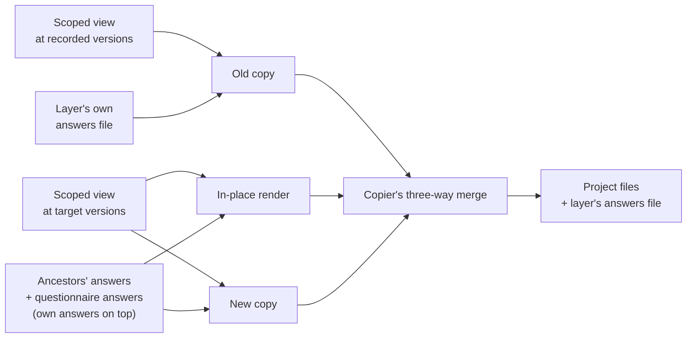
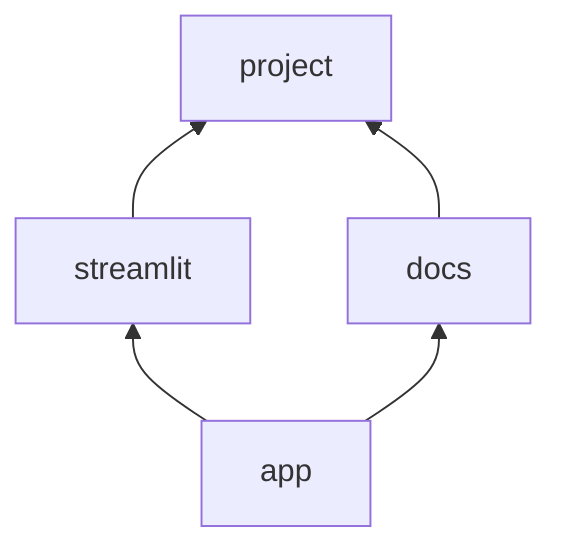

# Why composition works this way

Copier applies one template per answers file and updates each one on its own. Boilerplate adds composition on top: one questionnaire for the whole composition, and every layer rendered as the flattened template of itself and its ancestors. Each section below names one design choice, what Copier does on its own, the mechanisms tried, and what the probes found. The rules themselves live in [design 04](04-composition-engine.md#safe-update), [ADR-015](adr-015-idiomatic-artifacts.md) and [ADR-002](adr-002-copier-internals-shim.md).

## The model in one screen

- **One questionnaire** covers the whole composition, at compose and before each update walk.
- **Scoped view.** Each layer renders and records its answers as the flattened template of itself plus its ancestors, questions and Jinja extensions alike. The **full view**, every layer seeing the whole composition, is the alternative the probes compared it against.
- **One view per template version.** A `Worker` subclass holds the layer's scoped view at the recorded versions for Copier's old copy, and at the target versions for the in-place render and the new copy.
- **Update data.** The in-place render and the new copy receive the ancestors' recorded answers and the questionnaire's answers, with the layer's own recorded answers on top.
- **Changed questions stop the update.** A changed question that rejects a recorded answer stops the update before it writes a file.
- **Tasks** run once, on the finished project.
- **Walk order.** The update walk runs ancestors first.
- **File-path extensions** register as Python modules from each layer's source at the ref being rendered.

The update of one layer:

## Copier's own model

| Behavior | Source |
|---|---|
| Several templates in one project, one answers file each, updated separately | [Applying multiple templates to the same subproject](https://copier.readthedocs.io/en/stable/configuring/#applying-multiple-templates-to-the-same-subproject) |
| Update re-renders the recorded version, diffs it against the project, and re-applies the diff to the new version | [How the update works](https://copier.readthedocs.io/en/stable/updating/#how-the-update-works) |
| No template inheritance: "with Copier 1 template = 1 repo" | [Maintainer comment on copier#934](https://github.com/copier-org/copier/issues/934#issuecomment-1482958819); the issue asking for updatable template hierarchies was open on 2026-10-06 ([copier#934](https://github.com/copier-org/copier/issues/934)) |
| `!include` shares settings and questions between files of one template | [Include other YAML files](https://copier.readthedocs.io/en/stable/configuring/#include-other-yaml-files) |

## Questions and answers

### Inherited questions come from a join

**Question:** How does a child layer render a question its ancestor declares?

**Copier:** A template renders with the questions in its own `copier.yml` and nothing else.

| Tried | Result |
|---|---|
| Child uses ancestor questions without declaring them (2026-09-04) | **Fails.** The vanilla per-layer re-render of `streamlit` produced a different Dockerfile, and the update paused on a conflict no edit had caused. |
| Child redeclares every ancestor question it uses (2026-09-04) | **Holds.** Both layers updated cleanly in either order. |
| Boilerplate joins each layer with its ancestors (2026-09-30) | **Holds.** 8 updates across both orders exited 0 with no conflict markers, `.rej` files or unmerged paths. |

**Choice:** A template declares its own questions and the ancestor questions it overrides; Boilerplate joins the rest. A redeclared copy duplicates the ancestor's schema by hand and drifts when the ancestor renames or retypes the question.

### The old copy reads only the layer's own answers file

**Question:** Can the walk hand inherited answers to Copier's old copy as data?

**Copier:** The old copy renders with `data=self.subproject.last_answers`, the layer's own answers file (source only: [`copier/_main.py` lines 1408–1420](https://github.com/copier-org/copier/blob/v9.18.1/copier/_main.py#L1408-L1420)). The docs say only that update uses "the answers you provided when copied last time" ([Updating a project](https://copier.readthedocs.io/en/stable/updating/)).

| Tried | Result |
|---|---|
| `--data` and `--data-file` on a vanilla update (2026-09-29, 2026-09-30) | **Fails.** Passed data rendered the new copy and never reached the old copy, so a template edit on or beside a line that renders a passed-in answer conflicted every time. |
| `_external_data` naming another layer's answers file (2026-09-30) | **Fails.** It rendered at copy and rendered empty on update, because Copier's temporary renders lack the file. |
| Old copy of a question the target version removes, with the layer's answers passed and with no data (2026-10-06) | **Holds.** Both runs rendered the recorded `license=Apache-2.0` in the old copy, so the value came from the answers file. |

**Choice:** Each layer's answers file records every answer its scoped view declares, so the old copy finds them there. Passed data feeds the in-place render and the new copy.

### One questionnaire at compose and before each update

**Question:** Which value does a layer record when an ancestor adds a question in a new version and a descendant overrides its default?

**Copier:** Answers come from passed data, then the user, then the last answers, then defaults ([Configuration sources](https://copier.readthedocs.io/en/stable/configuring/#configuration-sources)).

The probe (2026-10-06): `project` v4 adds `license` with default `MIT`; `streamlit` v4 overrides the default to `Apache-2.0`; both layers update from v1 to v4.

| Tried | Result |
|---|---|
| Scoped views, no questionnaire pass | **Fails.** The outcome depended on order, with no error either way: `project` first recorded `MIT` in both answers files; `streamlit` first left `project`'s file rendering `MIT`, `project`'s answers at `MIT` and `streamlit`'s at `Apache-2.0`. |
| One non-interactive questionnaire over the full composition at the target versions before the walk, answering only questions no answers file records | **Holds.** `Apache-2.0` in the rendered file and in both answers files, in both orders. |
| Full view, no questionnaire pass | **Holds.** `Apache-2.0` everywhere; the full view fails on other grounds ([scoped view](#each-layer-sees-itself-and-its-ancestors)). |

**Choice:** One questionnaire covers the whole composition, at compose and before each update walk, and its answers sit under each layer's recorded answers.

### Each render uses the questions of the version it renders

**Question:** Which questions does each of Copier's three update renders use?

**Copier:** The old copy is a "fresh project from the current template version", the version recorded in the project ([How the update works](https://copier.readthedocs.io/en/stable/updating/#how-the-update-works)).

| Tried | Result |
|---|---|
| `project` v5 removes `license`, which v4's files render; old copy under the v4 view, new copy under the v5 view (2026-10-06) | **Holds.** The old copy rendered the recorded value, the update finished clean, and the v5 answers file dropped the key. |

**Choice:** The `Worker` subclass holds one scoped view per template version: the recorded versions' view for the old copy, the target versions' view for the in-place render and the new copy.

### A changed question that rejects a recorded answer stops the update

**Question:** What happens when a target version retypes a question, drops a choice, adds a validator, or renames a question?

**Copier:** A vanilla update deletes a last answer that fails to parse or validate and takes the new default; data passed by the caller gets no such fallback (source only: [`copier/_main.py` lines 623–652](https://github.com/copier-org/copier/blob/v9.18.1/copier/_main.py#L623-L652)). A renamed question moves its answer through [`_migrations`](https://copier.readthedocs.io/en/stable/configuring/#migrations).

| Tried (2026-10-06) | Result |
|---|---|
| `str` to `int`, recorded `"eighty"`, recorded answers passed as data | **Stops.** A `ValueError` before any in-place render left the tree and answers files untouched; the descendant's update stopped the same way because its answers file records the ancestor's question. |
| `str` to `int`, recorded `"8080"` | **Holds.** The answer became the integer `8080`. |
| Choice list drops the recorded `GPL-3.0` | **Stops.** `ValueError` before render. |
| Both retypes on a vanilla update, no data | **Silent.** Copier replaced `"eighty"` with `8080` and `GPL-3.0` with `MIT`, with no warning. |
| New validator rejects the recorded email, answers passed as data | **Stops.** `ValueError` before render. |
| New validator plus a valid new default, vanilla update | **Silent.** Copier rewrote the email to the new default in `pyproject.toml`, `README.md` and both answers files. |
| Rename with a before-stage migration in the ancestor only, ancestor updated first | **Holds.** The descendant read the migrated name from the ancestor's answers file. |
| Same, descendant updated first | **Partial.** The descendant recorded the template default `Your Name`, which stayed after the ancestor's update, with no error. |
| Migration shipped by both layers | **Holds** in both orders. |

**Choice:** The walk passes recorded answers as data, so a changed question that rejects one stops the update before it writes a file. The walk runs ancestors first, so an ancestor's migration lands before a descendant reads its answers file.

### The layer's own answers win

**Question:** When two answers files disagree, which value does a layer's update use?

**Copier:** Passed data outranks the answers file ([Configuration sources](https://copier.readthedocs.io/en/stable/configuring/#configuration-sources)).

| Tried | Result |
|---|---|
| Union of every layer's answers file as data, merge order unrecorded (2026-09-30) | **Holds** on that run; the merge order decides any disagreement, and the run did not record it. |
| Union of every answers file sorted by filename (full view, 2026-10-06) | **Holds** on that run; the filename order decides any disagreement. |

Answers files can disagree: the `license` run without a questionnaire ended with `MIT` in `project`'s file and `Apache-2.0` in `streamlit`'s.

**Choice:** The data for the in-place render and the new copy is the ancestors' recorded answers and the questionnaire's answers, with the layer's own recorded answers on top.

## Rendering each layer

### The view reaches every render through a `Worker` subclass

**Question:** How does a layer's view reach all three renders of a Copier update?

**Copier:** `Worker._apply_update` builds the old copy, the in-place render and the new copy with `dataclasses.replace`, which constructs each worker from dataclass fields (source only: [`copier/_main.py` lines 1388–1479](https://github.com/copier-org/copier/blob/v9.18.1/copier/_main.py#L1388-L1479)).

| Tried (2026-09-30) | Result |
|---|---|
| Merged template set on one worker instance | **Fails.** The first `streamlit` update exited 0 and dropped all five inherited answers from its answers file, the derived values rendered empty, and the second update paused with conflict markers. |
| `Worker` subclass holding the view in its fields | **Holds.** All 8 updates finished clean, the five inherited answers persisted, the derived values rendered and the user's line survived. |

**Choice:** A `Worker` subclass holds the views in its fields and builds `template` from the view that matches the `vcs_ref` Copier sets on each worker ([ADR-002](adr-002-copier-internals-shim.md#decision)).

### Each layer sees itself and its ancestors

**Question:** Which layers' questions and extensions does a layer's render see?

**Copier:** A worker builds its Jinja environment from its own template's `_jinja_extensions` (source only: [`copier/_main.py` lines 712–735](https://github.com/copier-org/copier/blob/v9.18.1/copier/_main.py#L712-L735)), and the answers file records only the template's declared, non-secret questions ([The `.copier-answers.yml` file](https://copier.readthedocs.io/en/stable/configuring/#the-copier-answersyml-file)).

The probe (2026-10-06): `streamlit` declares a context hook that overwrites `description` in every render it reaches.

| Tried | Result |
|---|---|
| Full view | **Fails.** The hook rewrote `description` in `project`'s `pyproject.toml` and `src/<package>/__init__.py`, and `project`'s answers file recorded `container_registry`, a `streamlit`-only question. |
| Scoped view | **Holds.** The hook reached only `streamlit`'s own `README.md`, `project`'s answers file recorded only `project`'s questions, and both views produced 32 files. |

All 16 updates in that probe, 8 per view across both orders and two versions, finished with no conflict markers, `.rej` files or unmerged paths. The answers-file keys still matter for the hand-run escape hatch: a vanilla per-layer update dropped a foreign key on its first rewrite (2026-09-04), and an undeclared answer survived one update and rendered empty on the next (2026-09-30).

**Choice:** Each layer renders and records its answers as its scoped view.

### Ancestor extensions reach descendants

**Question:** Can a descendant use a filter or hook its ancestor declares, without the descendant's hooks reaching the ancestor?

**Copier:** Extensions belong to the template that declares them, as above.

| Tried (2026-10-06) | Result |
|---|---|
| Descendant renders an ancestor's file-path filter with no registration | **Fails.** `TemplateAssertionError: No filter named 'probe_shout'.` |
| Diamond: `docs` declares a module extension, `app` below it renders the `shout` filter | **Holds.** Both `docs` and `app` rendered it. |
| Descendant declares a context hook; an ancestor's file renders the variable it sets | **Holds.** The ancestor's file stayed at its default after compose and every update. |

**Choice:** A layer's scoped view includes its ancestors' extensions and no descendant's.

### File-path extensions register per ref

**Question:** How does a descendant load an extension its ancestor declares by file path?

**Copier:** [`copier-templates-extensions`](https://github.com/copier-org/copier-templates-extensions#usage) loads extensions "using file paths relative to the template root", so a descendant's root does not hold the ancestor's file.

| Tried (2026-10-06) | Result |
|---|---|
| Absolute path with a Windows drive letter | **Fails.** The loader splits the entry at its first colon. |
| Rooted path with no drive letter | **Holds** on the one drive tested. |
| `../` path walking out of the template | **Fails** for git-cloned templates. |
| Ancestor's file registered as a module once, from the target ref's source | **Silent.** The old copy rendered with the target module, so old and new matched and the file stayed at its old text with no error. |
| Ancestor's file registered as a module from the source at each ref rendered | **Holds.** The file moved to the new text with no conflict markers. |

**Choice:** Boilerplate registers each layer's file-path extensions as Python modules from that layer's source at the ref being rendered.

## Running the walk

### Ancestors update first

**Question:** In which order does the walk update the layers?

**Copier:** Each template updates with its own `copier update -a <answers file>` command, in whatever order the user runs them ([Applying multiple templates](https://copier.readthedocs.io/en/stable/configuring/#applying-multiple-templates-to-the-same-subproject)).

| Tried (2026-10-06) | Result |
|---|---|
| Both orders, scoped views (`license` with the questionnaire pass; three-layer chain) | **Holds** in both orders. |
| Both orders, no questionnaire pass | **Fails.** The order changed the recorded value. |
| Rename migrated by the ancestor only | **Partial.** Descendant first lost the value with no error. |

**Choice:** The walk runs in the composition's topological order, ancestors first.

### Diamonds and longer chains

**Question:** Does the scoped view hold beyond two layers?

Arrows point from a layer to the layer it extends. The walk order was `project`, `streamlit`, `docs`, `app`.

| Layer | Scoped view | Answers file records |
|---|---|---|
| `project` | `project` | `project`'s questions |
| `streamlit` | `project`, `streamlit` | + `container_registry` |
| `docs` | `project`, `docs` | + `docs_site` |
| `app` | all four | + `container_registry`, `docs_site` |

| Tried (2026-10-06) | Result |
|---|---|
| Diamond above, `docs` then `app` updated | **Holds.** No conflict markers, the user's line kept, and every answers file recorded its view's keys. The full view recorded all 10 keys in every file. |
| Chain `project` ← `streamlit` ← `extra`, both orders | **Holds.** Every file reached the new version with no markers and the user's line once; `extra`'s override of `container_registry` reached `streamlit`'s and `extra`'s answers files through the questionnaire. |
| User line placed beside a line the new version rewrites | **Pauses** with conflict markers, in the scoped and full views alike. |

**Choice:** A layer's scoped view is that layer plus every layer its `extends` chain reaches, directly or transitively.

### Tasks run once on the finished project

**Question:** Where do `_tasks` run at compose and at update?

**Copier:** In the update probe, Copier ran the updated layer's own `_tasks` three times: in the old copy's temporary directory, in place, and in the new copy's temporary directory (observed 2026-10-06).

| Tried (2026-10-06) | Result |
|---|---|
| Compose: every layer's tasks merged onto the final layer | **Partial.** Each task ran once in the destination; `{{ _copier_conf.answers_file }}` rendered as the final layer's answers file in `project`'s task too. |
| Update: each layer's own `_tasks` through Copier | **Partial.** Each task ran three times, and a file the task appended to in place was unchanged after the update. |

**Choice:** Tasks run once, on the finished project ([ADR-014](adr-014-deferred-task-execution.md)).

### Conflicts pause visibly, and Copier exits 0

**Question:** How does a conflicting update surface?

**Copier:** Inline conflict markers by default ([Updating a project](https://copier.readthedocs.io/en/stable/updating/#updating-a-project), [`conflict`](https://copier.readthedocs.io/en/stable/configuring/#conflict)); conflict handling raises no error, and the CLI returns 0 for anything but a user-message or unsafe-template error (source only: [`copier/_main.py` lines 1586–1665](https://github.com/copier-org/copier/blob/v9.18.1/copier/_main.py#L1586-L1665), [`copier/_cli.py` lines 76–92](https://github.com/copier-org/copier/blob/v9.18.1/copier/_cli.py#L76-L92)).

| Tried | Result |
|---|---|
| User edits the exact README line the new version changes (2026-10-06) | **Pauses.** No exception; `README.md` held `<<<<<<< before updating` / `>>>>>>> after updating`, git reported `UU README.md` with stages 1, 2 and 3, and no `.rej` file remained. |
| Vanilla `copier update` into a conflict (2026-07-28) | **Exit 0** with markers in the tree and the answers file already at the new tag. |

**Choice:** The walk detects a pause from git's unmerged state or a marker scan, never from Copier's exit code ([ADR-007](adr-007-update-model.md)).

## Layer directives

### Skip lists stay out of composed renders

**Question:** Does a layer's `_skip_if_exists` apply when Boilerplate composes?

**Copier:** Skip patterns cover files "that must be skipped only if they already exist" ([`skip_if_exists`](https://copier.readthedocs.io/en/stable/configuring/#skip_if_exists)), and Copier checks them before the overwrite flag (source only: [`copier/_main.py` lines 505–514](https://github.com/copier-org/copier/blob/v9.18.1/copier/_main.py#L505-L514)).

| Tried | Result |
|---|---|
| Each layer's own list applied at compose (2026-09-28, 2026-10-06) | **Fails.** A later layer skips any listed file an earlier layer has just written, and `project` and `streamlit` both list `README.md`; the first layer's list kept `README.md` out of `new --force`. |

**Choice:** A composed render ignores every layer's skip list, and each list governs that layer's own `copier update` ([design 04](04-composition-engine.md#per-layer-render-loop)).

### A declared `_exclude` restates Copier's defaults

**Question:** What happens when a template declares `_exclude`?

**Copier:** "When you define this parameter in `copier.yml`, it will **replace** the default value" ([`exclude`](https://copier.readthedocs.io/en/stable/configuring/#exclude)). The old copy also applies the target version's excludes (source only: [`copier/_main.py` line 1420](https://github.com/copier-org/copier/blob/v9.18.1/copier/_main.py#L1420)).

| Tried (2026-09-04) | Result |
|---|---|
| `project` declares `_exclude: [_extensions]` | **Fails.** A vanilla update copied the template clone's `.git` over the project's own. |

**Choice:** A template that declares `_exclude` restates Copier's default exclusions, and compose applies Copier's defaults to every layer's render.

## Sources and prompting

### Composing from git sources

**Question:** Can compose read layers straight from git repositories?

**Copier:** A git-backed `Template` exposes `git_index_modes`, a mapping keyed by `PurePosixPath` (source only: [`copier/_template.py` line 599](https://github.com/copier-org/copier/blob/v9.18.1/copier/_template.py#L599)).

| Tried (2026-10-06) | Result |
|---|---|
| Compose from git-repo layers | **Fails.** `TypeError: JSON object keys must be strings, got PurePosixPath`; `boilerplate new` exited 1. |
| Same, with `git_index_modes` left out of the config Boilerplate reads | **Holds.** Compose succeeded, and both answers files recorded `_commit: v2`, the latest tag, with `_src_path` set to the repository. |

**Choice:** Compose reads each layer's Copier config without `git_index_modes`.

### Prompt defaults show a descendant's overrides

**Question:** Does the interactive questionnaire show a descendant's default overrides?

**Copier:** "Copier will not ask any questions answered in the previous source" ([Configuration sources](https://copier.readthedocs.io/en/stable/configuring/#configuration-sources)).

| Tried (2026-10-06) | Result |
|---|---|
| Questionnaire over `streamlit`'s full composition, keystrokes piped in on Windows | **Holds.** 9 prompts appeared and the two derived questions did not; `dependencies` and `sample_module` defaulted to `streamlit`'s overrides; the typed `project_name` came back. `project_name`'s default was the name of a temporary directory, because the prompt's destination was one and `{{ _folder_name }}` resolves against it. |

**Choice:** The questionnaire runs over the whole composition, so each prompt's default is the composition's.

## Evidence and limits

The probes ran on Windows against Copier 9.18.1, except the 2026-07-28 run, which used Copier 9.15.0. The runs dated before 2026-10-06 are recorded in the Verification sections of [ADR-015](adr-015-idiomatic-artifacts.md) and [ADR-002](adr-002-copier-internals-shim.md); the 2026-10-06 probes built views with Boilerplate's own resolver and composer over scratch fixtures and drove Copier's update through a `Worker` subclass written for the probe.

Not yet verified:

- **Mixed ancestor versions in one view.** Every probe moved a layer and its ancestors in lockstep, on shared tag names.
- **Independent ancestor refs.** No probe fetched an ancestor at a ref the descendant never tagged.
- **Real bundled tasks at update.** The task probe used a marker task; the bundled `project` tasks would also run in Copier's temporary copies.
- **File-path extensions across drives.** The drive-less rooted path ran on one drive.
- **Boilerplate's own `update` command.** The update probes called Copier's `Worker` directly.
- **`_folder_name` in prompt defaults.** No probe ran the questionnaire against the real destination.

## Where next

- [Design 04 §Safe Update](04-composition-engine.md#safe-update): the update walk's normative rules.
- [ADR-015](adr-015-idiomatic-artifacts.md): why a composed project is Copier on disk.
- [ADR-002](adr-002-copier-internals-shim.md): the `Worker` subclass and the shim around Copier's internals.
