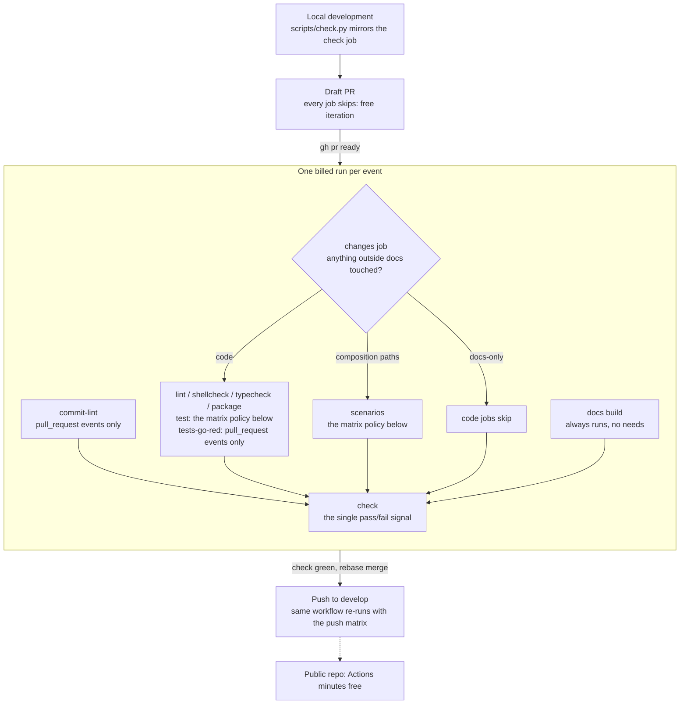

# CI Pipeline

How a change travels from your working tree to `develop`, what runs at each step, and why the pipeline is shaped the way it is. The pipeline lives in [`.github/workflows/ci.yml`](https://github.com/TheRealBillSiegler/boilerplate/blob/develop/.github/workflows/ci.yml); a separate workflow builds the downloadable offline docs bundle.

## The whole flow

A change moves from local checks to a draft pull request, then to one billed run once the pull request is ready, through the `check` gate, and on to a push to `develop` that runs the workflow again.



## Triggers

- `push` to `main` or `develop`.
- `pull_request` targeting `main` or `develop`, with `ready_for_review` added to the default activity types — without it, a draft flipped to ready would never get a CI run.
- Superseded runs are cancelled (`concurrency` with `cancel-in-progress`): PRs group per ref, pushes group per branch.

## The dispatcher: `changes`

The first job diffs the run's commit range and classifies every changed file as **docs** (`docs/`, `*.md`, `mkdocs.yml`) or **code** (anything else). The six code jobs run only when something outside docs changed. It also flags **composition** when a changed file matches one of these paths; the scenarios job runs only then.

| Path | Why it counts |
| --- | --- |
| `src/boilerplate/` | The scenarios drive the CLI, which reaches every package there |
| `tests/integration/boilerplate/composition/` | The scenarios themselves |
| `tests/boilerplate/templates/` | The template fixtures the scenarios build on |
| `tests/fixtures/family/` | The made-up template family |
| `uv.lock` | The scenarios run against the locked dependency versions |
| `.github/workflows/ci.yml` | The workflow itself |

| Event | BASE | HEAD |
| --- | --- | --- |
| `pull_request` | PR base SHA | PR head SHA |
| `push` | `github.event.before` (branch tip before the push) | `github.sha` (tip after) |

When BASE is unusable — empty, the zero SHA of a branch-creation push, or an object the clone no longer has after a force-push — the dispatcher falls back to running everything, the scenarios included. The failure mode of the fallback is a few wasted minutes, never a merge that skips validation. On `develop` and `main` the fallback is rare by construction: branch rules forbid non-fast-forward pushes.

## Draft PRs cost nothing

`changes`, `docs`, and `check` each carry the guard `github.event_name != 'pull_request' || !github.event.pull_request.draft`; `commit-lint` carries the same draft term inside its PR-only condition. Every other job `needs: changes`, so when `changes` skips, they all skip transitively. `check` skips too — a draft never shows a vacuously green check. Iterate on drafts freely; flip ready when the local check passes.

## Test matrix policy

| Repository | Event | `test` legs | `scenarios` legs |
| --- | --- | --- | --- |
| Public | `pull_request`, `push` | ubuntu, windows, macos × 3.12, 3.13, 3.14 | the same nine |
| Private | `pull_request` | ubuntu × 3.12, 3.13, 3.14 | ubuntu × 3.14 |
| Private | `push` | ubuntu, windows, macos × 3.14, plus ubuntu × 3.12 and 3.13 | ubuntu × 3.14 |

The full cross product runs wherever Actions minutes are free, and a public repository's standard runners cost nothing. While the repository is private, minutes are metered and Windows bills 2× and macOS 10×, so PRs run every supported Python on Linux and pushes to `develop` and `main` run every OS on the newest Python; development and the local check already exercise Windows. The workflow reads the visibility from the event (`github.event.repository.private`), so the switch needs no edit at the flip. Python 3.15 joins once it is final and every dependency ships a wheel for it; today `pywin32` does not.

## Composition scenarios

The scenarios rerun the composition design's evidence against real Copier and git, and a full run takes minutes. The test job deselects them (`-m "not scenario"`); the `scenarios` job runs them under the matrix policy above, and only when the dispatcher flags composition. A docs-only change never pays for them. `check` waits on it like any other job.

## New tests go red

A PR that changes `src/` and adds tests must show at least one added test failing against the base commit's `src/` — otherwise none of them ever went red and the job fails, naming them. It runs on `pull_request` events only: a push has no base commit to diff added tests against. Script: [`scripts/new_tests_go_red.py`](https://github.com/TheRealBillSiegler/boilerplate/blob/develop/scripts/new_tests_go_red.py).

## Commit messages

Every commit in a PR must be a conventional commit whose first line is at most 72 characters, because rebase merges land each one on `develop` and release-please reads each one. The `commit-lint` job checks the whole PR range and is a need of `check`, so a bad message blocks the merge. It runs on `pull_request` events only (a push has no PR range) and skips on drafts; `check` treats that skip as a pass. Script: [`scripts/commit_lint.py`](https://github.com/TheRealBillSiegler/boilerplate/blob/develop/scripts/commit_lint.py).

## The docs job

The strict docs build (both the online config and the `DOCS_OFFLINE` release-bundle config) has no `needs` and ignores the path filter: mkdocstrings and autorefs build API pages from source, so a code-only change can break the docs build. Its only guard is the draft skip. It is a single cheap ubuntu runner.

## The `check` job

`check` is the one status check that matters: it passes when no needed job failed or was cancelled, so jobs skipped by the path filter, or by event (`commit-lint` and `tests-go-red` on pushes), don't break it. Configure required checks against `check` alone, never against individual jobs.

## Timeouts

Every job sets `timeout-minutes` (5–45 by job). The GitHub default is 360, which would let a single job that stops responding use up hours of runner time — on a 2× or 10× runner, a large slice of a month's included minutes.

## The local check

Run before every push:

```powershell
uv run python scripts/check.py
```

It mirrors CI's billable `check` — ruff check `--no-fix`, `ruff format --check`, the commit-range lint, pyright, the pytest suite without the scenarios, doctests, and both strict docs builds. It runs the scenarios too when a composition path differs from the merge base with `origin/develop`, or when it cannot find that merge base, and prints which it chose and why. A failure caught locally costs seconds; the same failure in CI costs a full billed run plus the rerun after the fix.

Next: [Versioning & Compatibility](versioning.md) — how releases are numbered and what compatibility they promise.
