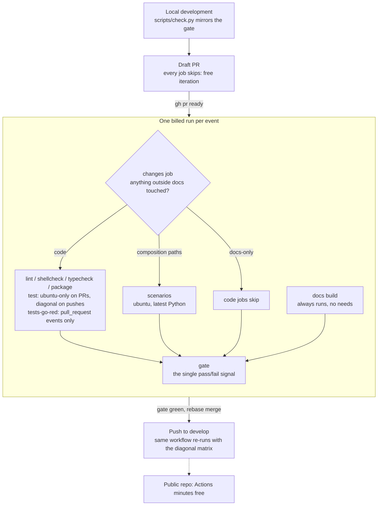

# CI Pipeline

How a change travels from your working tree to `develop`, what runs at each step, and why the pipeline is shaped the way it is. The pipeline lives in [`.github/workflows/ci.yml`](https://github.com/TheRealBillSiegler/boilerplate/blob/develop/.github/workflows/ci.yml); a companion workflow lints every commit in the PR against conventional-commit types, and a third builds the downloadable offline docs bundle.

## The whole flow



## Triggers

- `push` to `main` or `develop`.
- `pull_request` targeting `main` or `develop`, with `ready_for_review` added to the default activity types — without it, a draft flipped to ready would never get a CI run.
- Superseded runs are cancelled (`concurrency` with `cancel-in-progress`): PRs group per ref, pushes group per branch.

## The dispatcher: `changes`

The first job diffs the run's commit range and classifies every changed file as **docs** (`docs/`, `*.md`, `mkdocs.yml`) or **code** (anything else). The six code jobs run only when something outside docs changed. It also flags **composition** when a changed file matches one of these paths; the scenarios job runs only then.

| Path | Why it counts |
| --- | --- |
| `src/boilerplate/` | The scenarios drive the CLI, which reaches every package there |
| `tests/integration/boilerplate/composition/` | The scenarios themselves |
| `tests/boilerplate/templates/` | The template fixtures the scenarios build on |
| `tests/fixtures/family/` | The made-up template family |
| `uv.lock` | The scenarios run against the locked dependency versions |
| `.github/workflows/ci.yml` | The workflow itself |

| Event | BASE | HEAD |
| --- | --- | --- |
| `pull_request` | PR base SHA | PR head SHA |
| `push` | `github.event.before` (branch tip before the push) | `github.sha` (tip after) |

When BASE is unusable — empty, the zero SHA of a branch-creation push, or an object the clone no longer has after a force-push — the dispatcher falls back to running everything, the scenarios included. The failure mode of the fallback is a few wasted minutes, never a merge that skips validation. On `develop` and `main` the fallback is rare by construction: branch rules forbid non-fast-forward pushes.

## Draft PRs cost nothing

`changes`, `docs`, and `gate` each carry the guard `github.event_name != 'pull_request' || !github.event.pull_request.draft`. Every other job `needs: changes`, so when `changes` skips, they all skip transitively. The gate skips too — a draft never shows a vacuously green check. Iterate on drafts freely; flip ready when the local gate passes.

## Test matrix policy

| Event | Legs |
| --- | --- |
| `pull_request` | ubuntu-latest × 3.13 |
| `push` | ubuntu × {3.12, 3.13}, windows × 3.13, macos × 3.13 |

PRs run one leg because development and the local gate already exercise Windows; CI's marginal PR signal is the POSIX leg. Pushes run the *diagonal* instead of the full OS × version cross product: OS-specific bugs are Python-version-independent and version-specific bugs are OS-independent, so the missing cells add multiplier cost without adding coverage. Windows and macOS breakage cannot land silently — it is caught by the merge-time push run.

## Composition scenarios

The scenarios rerun the composition design's evidence against real Copier and git, and a full run takes minutes. The test job deselects them (`-m "not scenario"`); the `scenarios` job runs them on one leg, ubuntu with the latest Python, and only when the dispatcher flags composition. A docs-only change never pays for them. The gate waits on the job like any other.

## New tests go red

A PR that changes `src/` and adds tests must show at least one added test failing against the base commit's `src/` — otherwise none of them ever went red and the job fails, naming them. It runs on `pull_request` events only: a push has no base commit to diff added tests against. Script: [`scripts/new_tests_go_red.py`](https://github.com/TheRealBillSiegler/boilerplate/blob/develop/scripts/new_tests_go_red.py).

## The docs job

The strict docs build (both the online config and the `DOCS_OFFLINE` release-bundle config) has no `needs` and ignores the path filter: mkdocstrings and autorefs build API pages from source, so a code-only change can break the docs build. Its only guard is the draft skip. It is a single cheap ubuntu runner.

## The gate

`gate` is the one status check that matters: it passes when no needed job failed or was cancelled, so jobs skipped by the path filter don't break it. Configure required checks against `gate` alone, never against individual jobs.

## Timeouts

Every job sets `timeout-minutes` (5–25 by job). The GitHub default is 360, which would let a single hung job burn hours of runner time — on a 2× or 10× runner, a large slice of a month's included minutes.

## The local gate

Run before every push:

```powershell
uv run python scripts/check.py
```

It mirrors the billable gate — ruff check `--no-fix`, `ruff format --check`, the commit-range lint, pyright, the pytest suite without the scenarios, doctests, and both strict docs builds. It runs the scenarios too when a composition path differs from the merge base with `origin/develop`, or when it cannot find that merge base, and prints which it chose and why. A failure caught locally costs seconds; the same failure in CI costs a full billed run plus the rerun after the fix.

Next: [Versioning & Compatibility](versioning.md) — how releases are numbered and what compatibility they promise.
