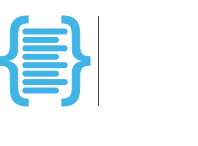

# Boilerplate

--8<-- "README.md:opening"

<figure class="demo">
  <div id="demo-cast" role="region" aria-label="Terminal recording: boilerplate new project asks a few questions and creates a project, then uv run pytest runs its tests."></div>
  <figcaption>New project, dependencies installed, pytest passing.</figcaption>
</figure>

The [Quickstart](quickstart.md) shows the same steps in text.

[Quickstart](quickstart.md){ .md-button .md-button--primary } [Browse Templates Hub](templates-hub/index.md){ .md-button }

!!! tip "Coming from Copier?"
    Start with [Why Boilerplate?](why.md) for the pitch, or go straight to [Template Composition](templates-hub/composition.md) for the `extends` mechanics.

!!! tip "Already on uv?"
    `uv init` gives you a package; Boilerplate gives you the judgment around it.

!!! tip "Evaluating Boilerplate?"
    [Why Boilerplate?](why.md) covers the ethos and the environment; [Implementation Status](status.md) shows what is implemented.

---

## Why choose Boilerplate?

<div class="grid cards" markdown>

-   :material-rocket-launch:{ .lg .middle } **Instant productivity**

    ---

    Scaffold fully configured projects with one command.

-   :material-package-variant-closed:{ .lg .middle } **Locked dependencies**

    ---

    `uv.lock` pins the environment, so every machine resolves the same.

-   :material-tools:{ .lg .middle } **Toolchain**

    ---

    `uv`, `ruff`, and `pytest` arrive preconfigured and ready to go, plus a strict `pyright` configuration checked live via Pylance.

-   :material-earth:{ .lg .middle } **Cross-platform**

    ---

    Windows 11 installs are automated; Linux/WSL2 and macOS follow the same steps manually.

-   :material-cog:{ .lg .middle } **Minimal configuration**

    ---

    Defaults from the first render, so there is less setup before you write code.

-   :material-puzzle:{ .lg .middle } **[Template composition](templates-hub/composition.md)**

    ---

    Layer templates with `extends` — one command, one merged question set, deterministic precedence when layers overlap.

</div>

!!! note "Planned"
    `boilerplate update` — a three-way merge that consumes the lock `boilerplate new` writes to move a generated project to a newer template version — is planned. See the [roadmap](roadmap.md) for sequencing, the [update model design](design/adr-007-update-model.md) for the approach, and [Implementation Status](status.md) for what exists today.

---

## Mini quickstart

=== "Windows 11"

    <!-- x-release-please-start-version -->

    ```powershell
    # Install (-ExecutionPolicy Bypass is per-process only)
    powershell -ExecutionPolicy Bypass -Command "irm https://raw.githubusercontent.com/TheRealBillSiegler/boilerplate/v0.4.0/scripts/install.ps1 | iex"
    # Scaffold
    boilerplate new project my-first-project
    ```

    <!-- x-release-please-end -->

=== "macOS and Linux"

    With [Git](https://git-scm.com/) and [uv](https://docs.astral.sh/uv/getting-started/installation/) installed:

    <!-- x-release-please-start-version -->

    ```bash
    uv tool install git+https://github.com/TheRealBillSiegler/boilerplate.git@v0.4.0
    boilerplate new project my-first-project
    ```

    <!-- x-release-please-end -->

Then run `uv run pytest` inside `my-first-project`. The [Quickstart](quickstart.md) walks every step with expected output, and [Installation](install.md#setup-options) covers manual setup.

---

## Explore further

<div class="grid cards" markdown>

-   :material-flag-checkered:{ .lg .middle } **[Quickstart](quickstart.md)**

    ---

    Scaffold, install, and run your first project.

-   :material-console:{ .lg .middle } **[CLI reference](cli.md)**

    ---

    Commands, options, and examples.

-   :material-download:{ .lg .middle } **[Installation](install.md)**

    ---

    Manual setup for Linux, WSL2, and macOS.

-   :material-view-grid-plus:{ .lg .middle } **[Templates Hub](templates-hub/index.md)**

    ---

    Explore available templates and where to start.

-   :material-microsoft-visual-studio-code:{ .lg .middle } **[VS Code configuration](environment/vscode.md)**

    ---

    Set up the recommended editor experience.

-   :material-toolbox:{ .lg .middle } **[Toolchain deep dive](environment/index.md)**

    ---

    See how the tools fit together.

-   :material-sitemap:{ .lg .middle } **[Developer platform architecture](reference/platform/index.md)**

    ---

    The reference model and standards.

-   :material-account-group:{ .lg .middle } **[Contributing](governance/contributing.md)**

    ---

    Development setup and coding standards; see also the [Security policy](governance/security.md).

-   :material-help-circle:{ .lg .middle } **[FAQ](faq.md) & [Troubleshooting](troubleshooting.md)**

    ---

    Answers to common questions and fixes for common setup issues.

</div>

---

<div class="brand-mark" markdown>
{ width="280" }
</div>
